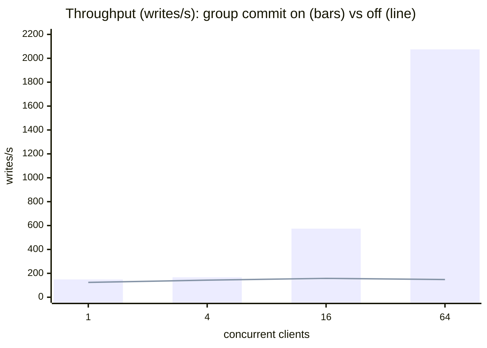
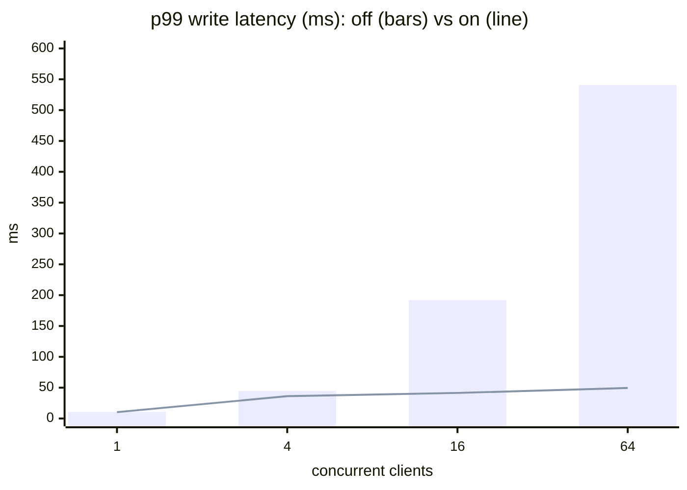
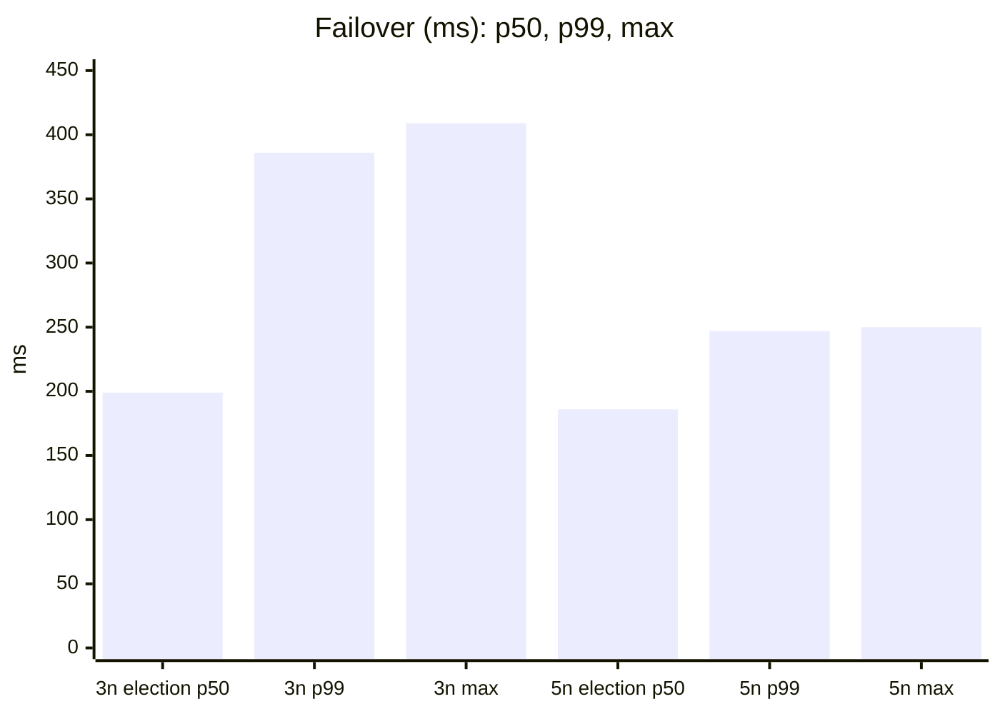

# Benchmarks

What the cluster does on real processes with real disk flushes, measured on 2026-11-27. The same results,
with interactive charts, are in the dashboard's **Benchmarks** tab (`./gradlew :raft-dashboard:run`,
http://localhost:8090). Every run is saved as JSON in `results/` (`load-*.json`, `failover-*.json`).

## Headline

| | Result |
|---|---|
| Group commit, 3 nodes, 64 clients, writes only | **148 → 2,075 writes/s (14×)**, p99 **541 → 50 ms** |
| Leader failover, 100 × `kill -9`, 3 nodes | election **p50 199 ms, p99 386 ms**, max 409 ms |
| Leader failover, 100 × `kill -9`, 5 nodes | election **p50 186 ms, p99 247 ms**, max 250 ms |
| Idle read vs write latency (ReadIndex) | **0.4 ms vs 8.0 ms** (p50) |
| Timeouts | **0** in 96 matrix runs |
| Docker (Linux), 3 nodes, 64 clients | 4,655 writes/s, p99 24 ms (fsync durability not verified, see below) |

## How it was measured

| | |
|---|---|
| Machine | One MacBook, Apple silicon, 11 CPUs. All nodes run on it as separate JVMs (`raft-bench`'s `ProcessCluster`). |
| Durability | A write is answered only after the leader and a majority have flushed it. On macOS Java's `force(true)` measures the same as `F_FULLFSYNC` (≈ 3 ms), a real flush to the SSD. |
| Clients | Closed loop: each client (a real `HttpClusterClient`) sends one request, waits, sends the next. Latency is measured at the client, retries included. |
| Workload | 1,000 keys, 100-byte values. "Writes only" = all PUT; "50% writes" = half PUT, half linearizable GET. |
| Timing | 3 s warm-up (not counted), 15 s measured. Every setting ran 3 times; tables show the **median**. |
| Command | `./gradlew :raft-bench:run --args="matrix --repeat 3"` (96 runs, ~37 min); `failover --nodes 3 --kills 100` |

## 1. Group commit: throughput

3 nodes, writes only, writes per second.



**Why:** the disk flush (3–6 ms) is the bottleneck. Without group commit each write pays its own flush,
one after another, so throughput stays near 150/s however many clients send. With group commit the server
drains everything that arrived during the previous flush and saves it all with **one** flush
(DESIGN.md M6-A):

| Clients | 1 | 4 | 16 | 64 |
|---|---|---|---|---|
| Writes per fsync (group commit on) | 1.2 | 3.6 | 12.7 | 45.0 |

## 2. Group commit: tail latency

3 nodes, writes only, p99 write latency (99% of writes were faster).



**Check with Little's law** (clients = throughput × latency): 64 / 148 writes/s ≈ 432 ms, measured p50
442 ms; 64 / 2,075 ≈ 31 ms, measured p50 31 ms. The latency *was* the queue, so removing the queue fixed
throughput and latency together.

## 3. All settings (local JVMs, medians of 3)

| Nodes | Group commit | Workload | Clients | ops/s | write p50 | write p99 | read p50 | read p99 |
|---|---|---|---|---|---|---|---|---|
| 3 | off | writes only | 1 | 124 | 8.9 | 10.7 | – | – |
| 3 | off | writes only | 4 | 143 | 29.9 | 44.7 | – | – |
| 3 | off | writes only | 16 | 158 | 93.0 | 192.0 | – | – |
| 3 | off | writes only | 64 | 148 | 442.4 | 540.7 | – | – |
| 3 | **on** | writes only | 1 | 149 | 6.7 | 10.3 | – | – |
| 3 | **on** | writes only | 4 | 167 | 24.0 | 36.2 | – | – |
| 3 | **on** | writes only | 16 | 574 | 28.1 | 41.5 | – | – |
| 3 | **on** | writes only | 64 | **2,075** | 30.9 | 49.5 | – | – |
| 3 | off | 50% writes | 1 | 268 | 6.9 | 10.0 | 0.4 | 1.6 |
| 3 | off | 50% writes | 4 | 257 | 17.7 | 39.0 | 11.0 | 27.1 |
| 3 | off | 50% writes | 16 | 287 | 46.1 | 107.7 | 60.7 | 111.6 |
| 3 | off | 50% writes | 64 | 285 | 161.5 | 342.0 | 278.0 | 388.9 |
| 3 | **on** | 50% writes | 1 | 238 | 8.0 | 11.4 | 0.4 | 1.8 |
| 3 | **on** | 50% writes | 4 | 270 | 17.9 | 32.8 | 11.8 | 27.0 |
| 3 | **on** | 50% writes | 16 | 604 | 25.9 | 39.0 | 27.3 | 41.2 |
| 3 | **on** | 50% writes | 64 | **2,017** | 30.4 | 44.8 | 32.6 | 51.1 |
| 5 | off | writes only | 1 | 103 | 9.5 | 15.0 | – | – |
| 5 | off | writes only | 4 | 123 | 32.9 | 46.0 | – | – |
| 5 | off | writes only | 16 | 135 | 113.0 | 188.3 | – | – |
| 5 | off | writes only | 64 | 119 | 534.5 | 764.4 | – | – |
| 5 | **on** | writes only | 1 | 111 | 8.9 | 15.0 | – | – |
| 5 | **on** | writes only | 4 | 142 | 28.0 | 42.2 | – | – |
| 5 | **on** | writes only | 16 | 392 | 40.8 | 60.4 | – | – |
| 5 | **on** | writes only | 64 | **1,234** | 51.9 | 80.0 | – | – |
| 5 | off | 50% writes | 1 | 202 | 9.1 | 14.9 | 0.5 | 1.8 |
| 5 | off | 50% writes | 4 | 229 | 20.7 | 39.0 | 13.6 | 30.0 |
| 5 | off | 50% writes | 16 | 258 | 51.7 | 117.2 | 68.6 | 124.0 |
| 5 | off | 50% writes | 64 | 248 | 193.3 | 403.5 | 309.2 | 457.0 |
| 5 | **on** | 50% writes | 1 | 210 | 8.7 | 15.0 | 0.5 | 2.2 |
| 5 | **on** | 50% writes | 4 | 238 | 19.9 | 36.0 | 13.0 | 30.2 |
| 5 | **on** | 50% writes | 16 | 500 | 31.4 | 49.0 | 33.0 | 54.9 |
| 5 | **on** | 50% writes | 64 | **1,312** | 47.0 | 69.3 | 50.5 | 77.6 |

Latencies in ms. "–" = no reads in that workload.

**3 vs 5 nodes:** 5 nodes is slower (1,234 vs 2,075 writes/s at 64 clients). The leader sends each entry
to 4 followers instead of 2 and waits for 3 flushes instead of 2, and here all 5 JVMs share one laptop.
More nodes buy fault tolerance (5 survive 2 failures), not speed.

**Reads:** an idle read takes 0.4 ms against 8 ms for a write. ReadIndex needs no log entry and no flush,
only one heartbeat round to confirm leadership. Under load reads wait about as long as writes. The likely
reason is that they queue behind writes on the single event loop, but that is a hypothesis, not a
measurement (DEVIATIONS.md BM5).

## 4. Leader failover

The leader is killed with `kill -9` while a probe client writes; the old leader is restarted and caught
up before the next kill. **Election** = kill → a node reports leader in a newer term. **Client gap** = the
longest pause between two completed writes around the kill.

| Cluster | Kills | Election p50 / p99 / max | Client gap p50 / p99 / max | Split votes |
|---|---|---|---|---|
| 3 nodes | 100 | 199 / 386 / 409 ms | 212 / 399 / 410 ms | 2 |
| 5 nodes | 100 | 186 / 247 / 250 ms | 204 / 269 / 271 ms | 0 |



**Why about 200 ms:** followers start an election only after a random 150–300 ms without heartbeats, so
the median lands near the middle; the vote itself takes a few ms on localhost. The client gap is 10–20 ms
longer because the client must also find the new leader. The 3-node p99 comes from 2 kills where two
followers timed out together and split the vote (the term rose by 2, at 373 and 386 ms). Every kill
recovered, and no acknowledged write was lost.

## 5. Docker (Linux) and the 40 ms bug

3 containers (`docker compose`), group commit on, writes only, measured with
`raft-bench load --attach 8081,8082,8083`. Medians of 3.

| Clients | Docker before fix | Docker after fix | Mac (local JVMs) |
|---|---|---|---|
| 1 | 20 ops/s, p50 51.1 ms | **543 ops/s, p50 1.6 ms** | 149 ops/s, p50 6.7 ms |
| 16 | 363 ops/s, p50 44.0 ms | **2,940 ops/s, p50 4.9 ms** | 574 ops/s, p50 28.1 ms |
| 64 | 1,396 ops/s, p50 45.9 ms | **4,655 ops/s, p50 13.1 ms** | 2,075 ops/s, p50 30.9 ms |

**The bug:** the first Docker run gave one client 20 writes/s at about 51 ms each. Narrowing it down:

1. `curl` writes took 5 ms, so the Raft server itself wasn't slow.
2. Java's client took 50 ms even for a request with no body, with HTTP/1.1 or HTTP/2.
3. The difference: Java reuses its connection. With `curl` on one reused connection the first request
   took 3.5 ms and **every later one 42 ms**.

The JDK HTTP server writes a response in two pieces; Nagle's algorithm holds the second until the first is
acknowledged; Linux delays that ACK by up to 40 ms. macOS loopback doesn't. **Fix:** `TCP_NODELAY`
(DESIGN.md M6-D). Re-measured locally after the fix: 142 vs 149 ops/s at 1 client and 2,140 vs 2,075 at
64 clients, within the usual spread, so the matrix above stands.

**Why Docker is faster than the Mac:** its Linux VM flushes in about 0.5–0.9 ms instead of 3 ms. Whether
that flush reaches the physical SSD as reliably as `F_FULLFSYNC` is **not verified**, so treat the Mac
numbers as the durable reference.

## 6. Is the flush real? (macOS)

Median time to write 4 KB and flush it, same APFS volume:

| Call | Median | p99 |
|---|---|---|
| `fsync()` | 0.03 ms | |
| `fcntl(F_FULLFSYNC)` | 2.97 ms | 4.08 ms |
| Java `FileChannel.force(true)` | 2.96 ms | 4.06 ms |

On macOS plain `fsync()` only reaches the drive's cache and can be lost on power failure; `F_FULLFSYNC`
forces data onto the flash. Java's `force(true)` costs the same as `F_FULLFSYNC` on JDK 21.0.11, so the
local numbers are durable numbers (this corrected DEVIATIONS.md S1).

## 7. Limits of these numbers

- **One laptop** (DEVIATIONS.md BM1): shared CPU and SSD, no network delay. On separate machines every
  write would also pay a network round trip.
- **Shared machine** (BM2): an IDE and a browser were open. Most repeats agree within 15%; the worst
  setting varied 39% (3 nodes, group commit off, 16 clients).
- **Closed-loop, small values** (BM3): 100-byte values, uniform keys, no snapshot during a run.
- **Docker durability** not verified (BM4).

## Reproduce

```
./gradlew :raft-bench:installDist
B=raft-bench/build/install/raft-bench/bin/raft-bench
$B matrix --repeat 3                                  # ~37 min, keep the machine idle
$B failover --nodes 3 --kills 100 ; $B failover --nodes 5 --kills 100
docker compose up -d --build
$B load --attach 8081,8082,8083 --label "docker" --clients 64 --repeat 3
```
