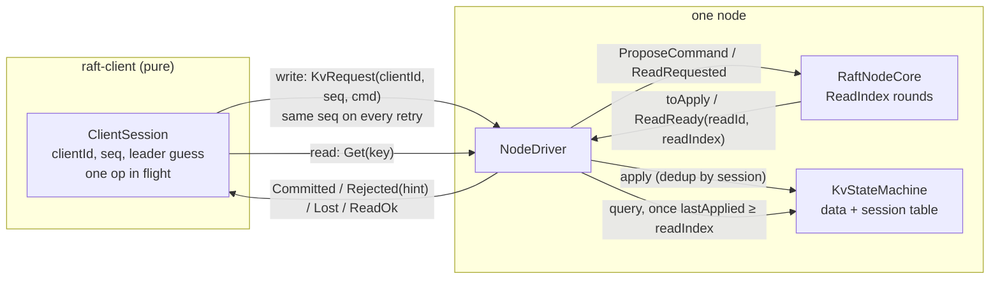
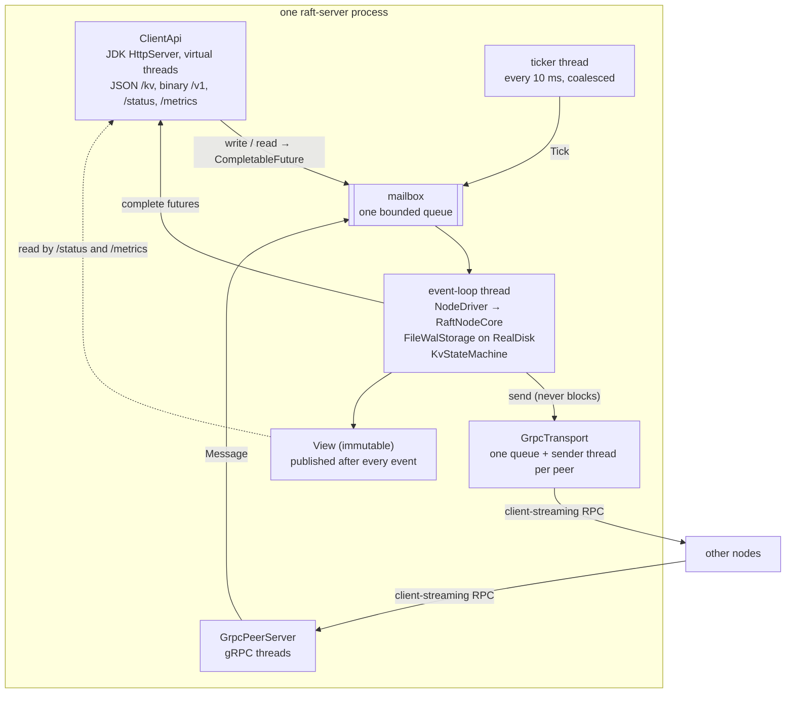
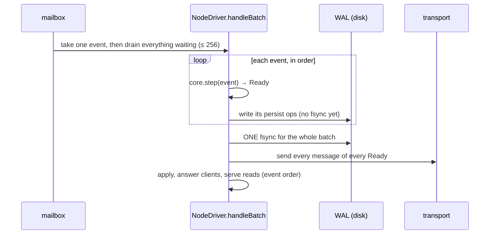

# Design decisions

Each entry: the decision, the alternatives we rejected, and why.

## D1. Durability and the core's in-memory log

**Decision.** Each node persists its own state through the `Storage` interface:
- hard state: `currentTerm` and `votedFor`
- the log entries
- a snapshot of the state machine (the sequence of applied commands up to `lastIncludedIndex`), from M3

On restart, `Storage.loadAll()` returns a `PersistentState`. The core is rebuilt from it and keeps an
in-memory copy of the log. While running, the core reads only that copy, and Storage is write-only
until the next restart. Snapshots bound how big the copy can get.

**Rejected.** The core reading entries through a synchronous `Storage` interface (etcd style). It uses
less memory, but it puts I/O and its failure modes inside the deterministic core.

**Why.** It keeps the core pure. Durability is a property of the driver: it persists first, then sends.
The core doesn't need to know about it.

### D1a. Snapshot boundary rules (M3)

The in-memory log is `(snapshotIndex, snapshotTerm, entries[snapshotIndex+1 ..])`.

1. **Compact only what has been applied.** The core trims entries `<= lastIncludedIndex` only when
   `lastIncludedIndex <= lastApplied`. Applied implies committed, so nothing it trims can ever be needed
   for a conflict check.
2. **The boundary still has a term.** `termAt(snapshotIndex)` returns `snapshotTerm`, so an
   AppendEntries with `prevLogIndex == snapshotIndex` passes the consistency check normally (Fig. 2).
   `termAt(i)` for `i < snapshotIndex` is empty, meaning compacted and not a mismatch.
3. **Follower gets `prevLogIndex < snapshotIndex`.** This is a stale or reordered AppendEntries, not a
   conflict. Skip the incoming entries with index `<= snapshotIndex` (they're committed and already in
   the snapshot) and process the rest. Never truncate below the snapshot.
4. **Leader with `nextIndex[p] <= snapshotIndex`.** The entries it would send are gone, so it sends
   InstallSnapshot instead of AppendEntries (§7).
5. **Follower receives InstallSnapshot** (Fig. 13):
   - If `lastIncludedIndex <= ` its own `commitIndex`, it's stale: reply and change nothing.
   - If its log has an entry at `lastIncludedIndex` with `lastIncludedTerm`, keep the suffix after it.
   - Otherwise discard the whole log.
   - Then persist the snapshot and the new log base, then restore the state machine.
6. `PersistentState` validation changes accordingly: the log starts at `snapshotIndex + 1`, and term
   monotonicity starts from `snapshotTerm`.

Still open for M3: where the snapshot bytes live while the leader streams them (held by the core vs.
read by the driver), and whether to chunk them.

## E1. Effect protocol: `step(event) -> Ready`

**Decision.** `RaftCore.step(event)` updates the core's in-memory state and returns a `Ready`.
The driver executes the `Ready` before it feeds the next event, in this order:
1. persist all ops, then fsync
2. send messages
3. apply committed entries
4. notify clients

Group commit (M6) keeps the same guarantee: the driver joins several `Ready`s, fsyncs once, and only
then sends their messages.

**Rejected.** An etcd-style `Ready()` / `Advance()` handshake. It allows sending while an fsync is
still in progress (thesis §10.2.1), but it has more states and the driver can misuse it.

**Why.** It's the simplest protocol in which "nothing leaves the node before it is durable" holds by
construction. Its one requirement is that the driver is single-threaded.

### E1a. Driver rules

1. **One mailbox.** Network threads, timers and client handlers never call the core. They only enqueue
   events into the event loop's FIFO queue. While a `Ready` is executing, new events wait in the queue,
   because nothing else can reach `step()`.
2. **A failed fsync stops the node.** If an fsync fails, the node stops processing (fail-stop: it exits,
   or crashes in the simulator) and recovers from disk on restart. It does not "skip sending and carry
   on", for two reasons:
   - The core has already advanced its in-memory state (it believes `votedFor = X` is durable), so it
     now disagrees with the disk.
   - After a failed fsync, Linux may discard the dirty pages, so a retried fsync can report success
     without the data being written ("fsyncgate", PostgreSQL 2018).

   The only safe recovery is to reload from what is actually on disk.
3. **Every message waits for the fsync**, including heartbeats that don't depend on new state. Sending
   them earlier would be an optimisation; it is not done in v1.
4. **The state machine is deterministic.** `apply` may depend only on the entry and the current state:
   - no wall clock, no randomness, no local configuration
   - anything time-based, such as session expiry, uses data carried in the entry
   - snapshot serialisation is canonical (sorted keys, e.g. TreeMap, never HashMap iteration order)

   Then two nodes at the same `lastApplied` produce byte-identical snapshots, and the simulator can
   assert exactly that.
5. **A snapshot is taken at exactly `lastApplied`,** between two `Ready`s, and includes the client
   session table. In v1 it is taken synchronously on the loop thread. That blocks the loop, which only
   affects liveness, so it will be marked `// SHORTCUT:`; copy-on-write snapshots are a possible M6 item.

## M2. Log replication decisions (approved 2026-11-22)

### M2-A. Flow control: send on proposal and on heartbeat; `nextIndex` moves only on replies
The leader sends AppendEntries (up to `maxEntriesPerAppend` entries from `nextIndex[p]`) to every peer
when a proposal is appended and on every heartbeat. `nextIndex` changes only when a reply arrives:
success raises it to `matchIndex + 1`, a rejection that answers the latest probe lowers it.
**Rejected:** etcd-style optimistic pipelining (Probe/Replicate modes, in-flight windows): much more
state and many more edge cases. Heartbeat-only sending: adds up to one heartbeat interval to every commit.
**Cost:** a slow follower can receive the same batch several times until it acks; throughput is about
one batch per round trip. Revisit in the M6 benchmarks.

### M2-B. Command encoding: hand-written binary codec
`DataOutputStream`/`DataInputStream`: a type byte, then fixed-width numbers and length-prefixed byte
strings. No dependencies, canonical (equal values give identical bytes, needed for M3 snapshot
comparison), and every byte is visible. Property-tested: `decode(encode(x)) == x`.
**Rejected:** protobuf now (build complexity before M5, and its encoding is not guaranteed canonical);
Java serialization (security risk, fragile, not a stable format).

### M2-C. Mutation hooks: a test-only `Set<ProtocolMutation>`
`RaftNodeCore.withMutationsForTesting(config, state, rng, mutations)` builds a core that breaks the named
rules. The public constructor always passes an empty set. Each mutation is one marked `if` at the
rule it breaks. **Rejected:** subclass overrides (non-final classes, `this-escape` lint); PIT
(slow, untargeted; possible M6 extra).

### M2-D. Simulated clients: open loop, no retries
**Superseded by M4-A.** Simulated clients propose random PUT/DELETE/CAS commands every 20–100 ms to the node they believe is
leader, follow rejection hints, and never retry an unknown outcome. M2 checks that replicas agree
(invariants 2–5); what clients observe (linearizability) is M4, together with retries and sessions.

### M2-E. Proposal bookkeeping in the driver
The core emits `ProposalAccepted(proposalId, index, term)`. The driver remembers `index → (proposalId,
term)`. When the entry at `index` is applied: same term means the proposal committed and gets the state
machine's result; a different term means it was overwritten by another leader and is answered
"lost, retry" (thesis §6.3). The command envelope carries `clientId` and `seq` from day one so that M4's
dedup does not change the log format.

## M3. Durability decisions (approved 2026-11-24)

### M3-A. One write-ahead log with typed records
Each node has one WAL: segment files `wal-<seq>.log` holding records
`[length u32][crc32c u32][type u8][payload]` of type HARD_STATE, ENTRIES, TRUNCATE, SNAPSHOT_MARK and
RESET (the first record of a checkpoint segment). Hard state lives in the same log as entries, so the
one fsync per `Ready` (E1) covers everything. Truncation is a logical record; bytes are never rewritten
in place, except to cut a torn tail. Recovery replays all segments: a bad record in the **last**
segment is a torn tail (cut it, fsync, stop); a bad record anywhere else is corruption (fail-stop).
After a snapshot, a checkpoint segment (RESET + HARD_STATE + retained entries) is written to a temp
file, fsynced, renamed, and the directory fsynced; only then are older segments deleted.
**Rejected:** a separate hard-state file (two fsyncs and a directory fsync per Ready); an embedded
database (hides what we are learning).

### M3-B. Crash testing: the real WAL on a simulated disk
`Disk` is a small file API (append, read, truncate, fsync, rename, delete, list, fsyncDir).
`RealDisk` uses `FileChannel`; `SimDisk` models a page cache: unsynced bytes are lost on crash, or a
random prefix of them survives (a torn write); a file name created, renamed or deleted becomes durable
only after `fsyncDir`; "crash during fsync" persists a random prefix of the pending bytes and fails.
The simulator runs the real `FileWalStorage` on `SimDisk`, so every seed exercises recovery.
**Rejected (for now):** only real files and kill -9 (slow and nondeterministic; that is M5's compose
test).

### M3-C. The core holds the latest snapshot's bytes
The core receives snapshot bytes through `SnapshotCreated`, a completed InstallSnapshot, or recovery,
and builds InstallSnapshot chunks from them. Pure and deterministic; the cost is one snapshot copy in
memory (a scale limit, listed in DEVIATIONS.md).
**Rejected:** the driver reading the snapshot file on demand (scales better, but message building leaks
into the driver).

### M3-D. Chunked InstallSnapshot (Figure 13)
Chunks carry `offset`, `data`, `done`; one chunk is in flight per follower and the reply carries how
many bytes the follower holds. 64 KB chunks in production, 64 bytes in the simulator so every install
is multi-chunk. The follower assembles chunks in volatile memory and restarts on an offset mismatch.

### M3-E. Snapshot every N applied entries, decided by the driver
Between two `Ready`s, when `lastApplied - snapshotIndex >= snapshotEvery`, the driver serializes the
state machine at exactly `lastApplied`, saves the snapshot file atomically (tmp, fsync, rename, fsync
dir), and only then tells the core (`SnapshotCreated`), which compacts its log and emits `CompactLog`.
Production 10,000; simulator 30-100.

### M3-F. Mutations that must be caught
Lying fsync (on the WAL now), recovery that does not cut the torn tail, a snapshot renamed into place
without fsyncing its data first, and a naive follower InstallSnapshot (no stale check, always discards
the log). Each one must be caught by a checker, with measured rates and a clean control run.

## M4. Clients and reads decisions (approved 2026-11-24)

Scope: only the parts that matter for correctness. Session expiry, RegisterClient, lease reads, follower
reads and client pipelining are skipped on purpose (DEVIATIONS.md K1–K5, EXPLANATION.md M4 §2).

### M4-A. Client model: a pure `ClientSession`, closed-loop simulated clients, lossy client links
`raft-client` holds `ClientSession`, a pure state machine with no network or clock. It keeps one
operation in flight: a write gets the next `seq`, and every retry re-sends exactly the same
`KvRequest(clientId, seq, command)`. Any attempt's success completes the operation; only the latest
attempt's failure or timeout triggers a retry. A rejection with a leader hint goes straight there; one
without a hint backs off (10 ms in the simulator) and tries another node; a timeout (150 ms) tries
another node. The simulator runs 5 closed-loop clients on it (think time 5–30 ms, 30% reads). Client
requests and replies travel over lossy links with the peer network's drop, duplicate and long-delay
probabilities. Each delivered copy gets its own proposal or read id at the node.
**Rejected:** clients inside the simulator only (M5's network client would have to re-implement the
retry rules); reliable client links (retries and duplicates would never happen, so dedup would go
untested; that was harness note H1).

### M4-B. ReadIndex with a read round carried on AppendEntries (thesis §6.4)
`ReadRequested(readId)` on a non-leader is rejected with the leader hint. On the leader:
1. Wait until it has committed an entry of its own term (its no-op). Before that its `commitIndex` can lag
   behind writes earlier leaders committed and acknowledged.
2. `readIndex = commitIndex`.
3. Start read round `r + 1` and send AppendEntries to every peer. `AppendEntries`, `InstallSnapshot` and
   both responses carry `readRound`; a response echoes it, success or not, because a reply in our term
   proves the follower still accepted us after the read arrived. A rejection of an **older** term's
   request echoes 0. It carries the follower's newer term, so an old term's round number would pass as a
   current ack (found by the gate, seed 4811; EXPLANATION.md M4 §15). The leader keeps
   `ackedRound[peer] = max(...)`, so reordered and duplicated replies are harmless, and releases every read
   whose round is at or below the round a majority (counting itself) has echoed. At most one round is in
   flight; reads arriving meanwhile batch into the next round. Heartbeats always carry the current
   round, so a lost round is retried.
4. The core emits `ReadReady(readId, readIndex)`; the driver serves it once `lastApplied ≥ readIndex`
   with `StateMachine.query`, which changes nothing.

Stepping down rejects every pending read. A deposed leader can never answer, because no majority
echoes its old term.
**Rejected:** lease reads (safety would depend on bounded clock drift; the brief forbids it); reads
through the log (a log entry and an fsync per read); a separate ReadIndex message type (the round field
on existing messages does the same job, as etcd's heartbeat context does).

### M4-C. Sessions live in the replicated state machine (thesis §6.3)
`KvStateMachine` keeps `clientId → (lastSeq, reply)` and decides at apply time:
- `seq == lastSeq` → return the saved reply without executing;
- `seq < lastSeq` → `KvResult.Stale` (an old copy nobody waits for);
- `seq > lastSeq` → execute and save.

Client 0 means "no session" (tools, tests and read queries). The table is in snapshot format v2 (sorted
by clientId, strictly checked) and in `stateHash`, so the replica checker compares it. It never expires
(owner decision, K1).
**Rejected:** dedup in the driver or the core (not replicated, so replicas would decide differently after
a crash or snapshot install).

### M4-D. Linearizability checker: Wing & Gong with Lowe's memoization, per key
At the end of each run, `LinearizabilityChecker` searches for a legal order of the recorded operations
(Porcupine's algorithm). It tries linearizing an operation at its invocation, backtracks at a response
that is not yet linearized, and memoizes (set of linearized operations, register state). The history is
split per key, since registers compose (linearizability is local). The model is `KvStateMachine`'s
semantics for one key. Operations without an answer get a response at +∞ and accept any output, so they
may take effect or not. A search budget (20 million steps) turns an undecidable history into a
failure with its own message. On failure it reports the operation with no legal point, the last
operations completed before it, and those overlapping it.
**Rejected:** Knossos/Porcupine as libraries (the brief asks for our own checker); a checker without
memoization (exponential on long histories).

### M4-E. History: one record per operation, unique values
`HistoryRecorder` records each client operation (not each attempt) from the client's invocation time to
the time it accepted an answer. Written values name their writer and seq (`c3-17`), so every value is
unique and a stale or duplicated effect cannot hide behind an equal value.

### M4-F. Mutations that must be caught, and a leader-targeted fault mix
`SKIP_DEDUP` (state machine re-executes duplicates), `READ_WITHOUT_QUORUM_CHECK` (no step 3) and
`READ_BEFORE_CURRENT_TERM_COMMIT` (no step 1), each caught by the linearizability checker, with clean
control runs. A bad ReadIndex is stale only in the short window around a leadership change. So the
read mutations run under `FaultConfig.leaderHunting()`, where 70% of faults isolate, pause or crash the
current leader. This plays the same role as batch size 1 for the Figure 8 mutation.

## M5. Hardening decisions (approved 2026-11-25)

### M5-A. PreVote, CheckQuorum and leader stickiness, behind flags (thesis §9.6, §6.2, §4.2.3)
- **PreVote.** When its election timer fires, a node first becomes `PRE_CANDIDATE` and asks
  `PreVote(term = currentTerm + 1, lastLogIndex, lastLogTerm)` **without** incrementing or persisting its
  term. A receiver says yes only if that term is above its own, it has **not** heard from a leader within
  an election timeout, and the candidate's log is at least as up to date. Neither side changes its term,
  its vote or its timer because of a PreVote. With a majority of yeses the node starts a normal election.
- **CheckQuorum.** A leader records which peers answered (AppendEntries or InstallSnapshot response, in its
  term). Every election timeout it checks: fewer than a majority including itself → it steps down to
  follower **in the same term** and rejects pending reads.
- **Stickiness.** With CheckQuorum on, a RequestVote with a higher term is ignored (no term change, no
  reply) by a node that heard from a leader within an election timeout. Without this an isolated node
  that skipped PreVote, or a restarted one, could still depose a healthy leader.
- **Flags.** `RaftConfig.preVote/checkQuorum` default to **off**, so the M1–M4 unit tests keep testing
  Figure 2 exactly. The simulator and the server turn both on. `SimConfig.withHardening(false, false)`
  reproduces the M4 protocol exactly; the mutation tests that PreVote or CheckQuorum would mask use it.
- **Measured** (`HardeningScenarioTest`, healthy cluster plus one scripted 3 s isolation, 100 seeds each):

| Scenario | PreVote | CheckQuorum | Result |
|---|---|---|---|
| isolate a follower | on | on | 0/100 runs disrupted, term growth 0 |
| isolate a follower | off | on | 100/100 runs: the rejoining node deposed the leader, term +26 |
| isolate the leader | on | on | old leader steps down after 99–204 ms (p50 ≈ 120 ms), term +1 to +2 |
| isolate the leader | on | off | old leader keeps the role 3,001–3,015 ms, until the heal |
| isolate the leader | off | on | steps down after 98–204 ms, but the old leader's elections push the term +24 |

**Rejected:** PreVote without stickiness (a restarted node's real RequestVote still disrupts); CheckQuorum
by timer only, with no per-peer activity (a leader that hears only one peer would believe it has quorum);
flags on in the core by default (would silently change what the M1–M4 unit tests verify).

### M5-B. gRPC transport: one client-streaming RPC per peer, bounded queue, drop when full
`raft.proto` (module `raft-proto`) mirrors `Message` one to one: `RaftMessage{from, to, term, oneof body}`.
`ProtoMapping` converts both ways and throws on a malformed message, which the server counts and drops.
`GrpcTransport.send` never blocks the event loop: it puts the message on that peer's
`ArrayBlockingQueue` (10,000) or **drops it** when full. Raft already tolerates loss: heartbeats and
retries resend what matters. One sender thread per peer drains its queue into a long-lived
`Stream(stream RaftMessage) returns (Ack)` call. It waits for gRPC flow control (`isReady`, 200 ms) and
on any error resets the stream and retries after 100 ms. Order within a stream is kept, but Raft doesn't
rely on it.
**Rejected:** unary RPC per message (a round trip per heartbeat, unbounded in-flight calls);
request/response RPCs matching Raft's shape (replies are already ordinary messages in our core, so a
one-way stream is simpler); blocking `send` (a slow peer would stall the whole node).

### M5-C. Client API: HTTP on the JDK server; `HttpClusterClient` and `raft-cli` on `ClientSession`
JSON for people (`PUT/GET/DELETE /kv/{key}`, `POST /kv/{key}/cas`, optional `Client-Id` + `Seq` headers
for exactly-once) and KvCodec bytes for programs (`POST /v1/write`, `/v1/read`). Status codes:
421 + `leaderId` = not the leader; 503 `retry` = outcome unknown, resend the same request; 503
`unavailable`; 504 = no answer in time; 409 = stale seq. `HttpClusterClient` is the simulator-tested
`ClientSession` driven over `java.net.http`, so the retry and seq rules are the same ones 5,000-seed
gates exercised. `raft-cli` is one client per invocation with a random id below 2²³ (attempt ids are
`clientId << 40 | n`).
**Rejected:** gRPC for clients (curl-ability matters for a demo, and the session logic is transport-free
anyway); Spring/Netty HTTP (a heavy dependency for five endpoints).

### M5-D. Node runtime: one event-loop thread, one mailbox; metrics from published views
Decision E1a, made real: gRPC threads, HTTP threads and the ticker only `offer` closures to one bounded
mailbox (50,000). One thread runs them through `NodeDriver`, so the core, log, WAL and state machine stay
single-threaded and effects keep the order persist + fsync → send → apply → notify. A full mailbox drops
peer messages (like loss) and answers clients 503. Ticks coalesce: at most one waits in the mailbox, so
a slow fsync delays timers instead of piling them up. After each event the loop publishes an immutable
`View` (status, last log index, matchIndexes). `/status` and the Micrometer gauges read only that.
Counters (elections, pre-vote rounds, leader changes, CheckQuorum step-downs) are derived from role
changes between consecutive views. `TimedDisk` wraps `RealDisk` to time every fsync. A
`NodeHaltedException` (failed fsync) or any unexpected exception halts the node: pending clients get
503 and the process exits with status 1 (fail-stop, never continue on unknown durable state).
**Rejected:** locks around the core (every rule would need re-proving under concurrency); metrics read
straight from the driver (a data race).

### M5-E. Real-process verification: kill -9 test and Docker
`KillNineIntegrationTest` (`./gradlew :raft-server:integrationTest`, tagged, not part of `build`) starts
three server JVMs on real files, runs four `HttpClusterClient`s with unique values, and SIGKILLs a node
(half the time the leader) every 0.8–1.5 s, restarting it 0.3–1.2 s later from its data directory.
After a quiet period it checks the history with the simulator's `LinearizabilityChecker`, and that every
node applied up to the leader's commit index. `raft-server/Dockerfile` builds the distribution in a JDK
stage and runs it on a JRE; `compose.yaml` starts three nodes with named volumes;
`docker compose kill nodeN` is a SIGKILL.

## M6. Benchmark decisions (approved 2026-11-25)

Measured results, with charts and caveats: [BENCHMARKS.md](BENCHMARKS.md) and the dashboard's
**Benchmarks** tab.

### M6-A. Group commit: drain the mailbox, one fsync per batch (etcd's Ready batching)

- **Rule E1 still holds per event:** nothing a step produced leaves the node before an fsync that covers
  its persist ops. Stepping event k+1 before event k is synced is safe because the core never reads
  storage (D1): it already assumed its own writes would be durable.
- **No timer.** The server never waits for a batch to fill; it takes whatever arrived while the previous
  fsync ran. One client sees the same latency as without batching; under load the batch grows by itself
  (1.2 events per fsync at 1 client, 45 at 64).
- **Server:** `RAFT_FSYNC_BATCH=true` (default), `RAFT_MAX_BATCH=256`. **Simulator:**
  `SimConfig.withBatching(ms)` holds a node's events in an inbox for up to `ms`, then hands them over as
  one batch, so crashes land inside batched fsyncs. The gate runs every fault mix with and without it.
- **Mutation `SEND_BEFORE_SYNC`:** messages leave as each event is stepped, before the batch's fsync.
  A crash inside that fsync then loses votes and entries other nodes already counted. Caught in 78/100
  seeds (crash loop + batching; Durability 74, Election Safety 4), and in 97/300 with the durability
  checkers off (Leader Completeness 75, Election Safety 22), so its real consequences are visible too.
  The control (same config, no mutation) is clean.

**Rejected:** a time window on the server (adds latency at low load for no gain; a drained mailbox is
already the natural batch); fsync on a separate thread with the leader sending in parallel (thesis
§10.2.1; faster, but changes the E1 ordering that every checker relies on, too large for the last
milestone).

### M6-B. `raft-bench`: real processes, closed-loop clients, medians of repeats
- `ProcessCluster` starts 3 or 5 `raft-server` JVMs on localhost (own ports, own data directory),
  SIGKILLs and restarts them, and polls `/status`. `ProcessCluster.attach(ports)` uses an
  already-running cluster instead (`raft-bench load --attach 8081,8082,8083` for docker compose).
- `LoadRun`: N closed-loop clients, each a real `HttpClusterClient` (sessions, redirects, retries), 1,000
  keys, 100-byte values, warm-up then measured window. Latency is measured at the client, retries
  included, in HdrHistogram. Server-side numbers (fsync time, events per fsync) come from the leader's
  `/metrics` after the run.
- `FailoverRun`: SIGKILL the leader N times while a probe client writes. **Election** = kill → another
  node reports leader in a newer term (5 ms polling). **Client gap** = the longest pause between two
  completed probe writes around the kill (not "kill → next success", which a write committed just before
  the kill would hide).
- `matrix`: nodes {3, 5} × group commit {off, on} × writes {100%, 50%} × clients {1, 4, 16, 64}, 3 repeats
  of 15 s each, reported as medians. `ResultStore` saves every run as JSON in `results/` with the git
  commit and machine.

**Rejected:** JMH (measures code in one JVM, not a cluster); open-loop load generation (needs a
coordinated-omission-aware setup; closed loop is simpler and Little's law checks it); an external tool
such as YCSB (would need a client binding; ours reuses the tested client).

### M6-C. `raft-dashboard`: a localhost lab (`MainApplication`, :8090)
JDK `HttpServer` + plain HTML/JS + vendored ECharts, no build step, one job at a time. Tabs: **Simulator**
(seeds, fault mix, toggles, a planted bug, per-seed drawer), **Blind bug test**, **Throughput & latency**
and **Leader failover** (run `raft-bench` live), **Compare runs** (any saved runs on one chart; series
keep Docker and local runs apart), **Benchmarks** (a fixed, explained report of the M6 numbers,
`benchmarks.js`).

**Blind bug test** (`BlindTest`): the user picks bugs and a count for each. They are dealt to random seeds
(shuffled by a plan seed) among clean ones, each bugged seed running under that bug's own fault profile
(or one fixed setting for all). The plan stays hidden until the end; then a confusion matrix (caught,
missed, false alarm, clean pass), per-bug detection, which checker caught what, and every seed's stats.
A failed seed keeps its stats up to the failure (`SimulationFailure.partial()`). **The number that
matters is false alarms (always 0 so far).** A miss means that seed's faults never reached the situation
the bug breaks.

**Rejected:** Spring Boot / a JS framework (a heavy dependency for one page); a static report only (the
owner wanted to explore runs interactively).

### M6-D. TCP_NODELAY on the client API (a bug the Docker benchmark found)
The JDK `HttpServer` writes a response's headers and body separately. With Nagle's algorithm the body waits
for the headers' ACK, and Linux delays that ACK by up to 40 ms, so every request on a kept-alive connection
took about 42 ms on Docker (20 ops/s for one client). macOS loopback never showed it. `ClientApi` sets
`sun.net.httpserver.nodelay=true` before the server classes load (a `-D` on the command line wins);
`ClientApiNoDelayTest` pins it. Docker: 20 → 543 ops/s at 1 client, 1,396 → 4,655 at 64. Local numbers
unchanged (re-measured: 142 vs 149 and 2,140 vs 2,075 ops/s, within the spread).
