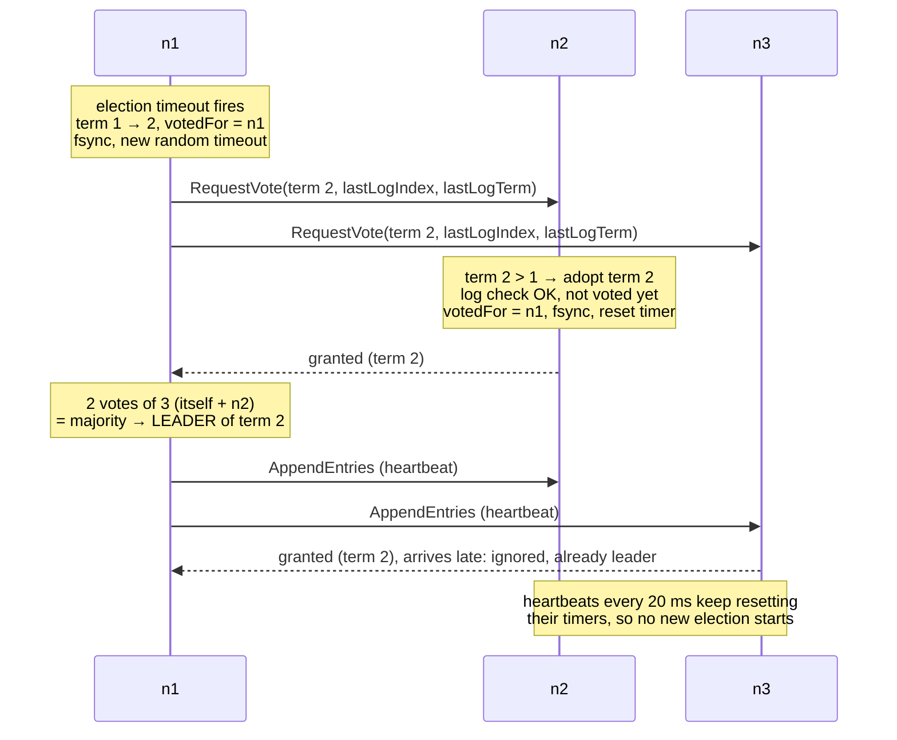
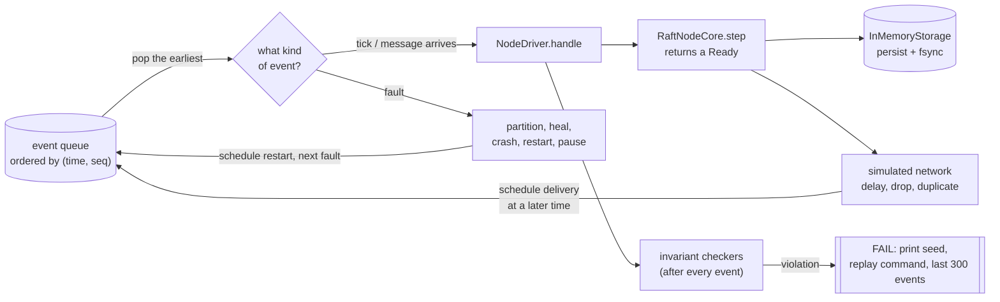
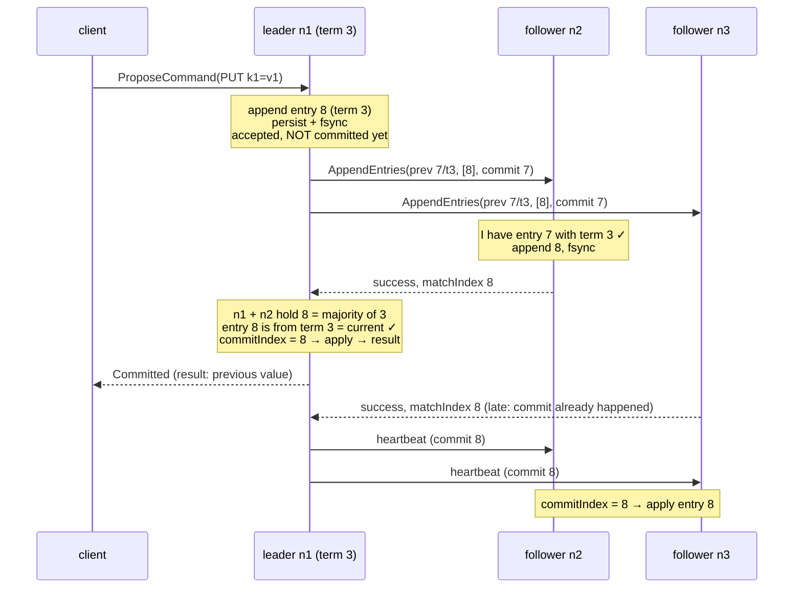
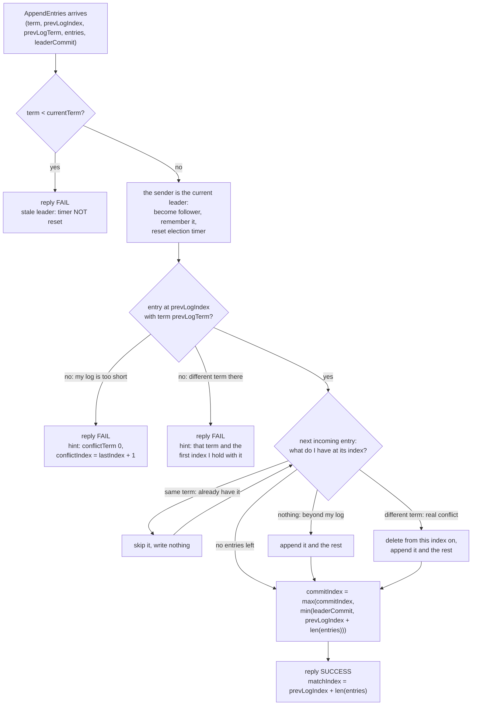
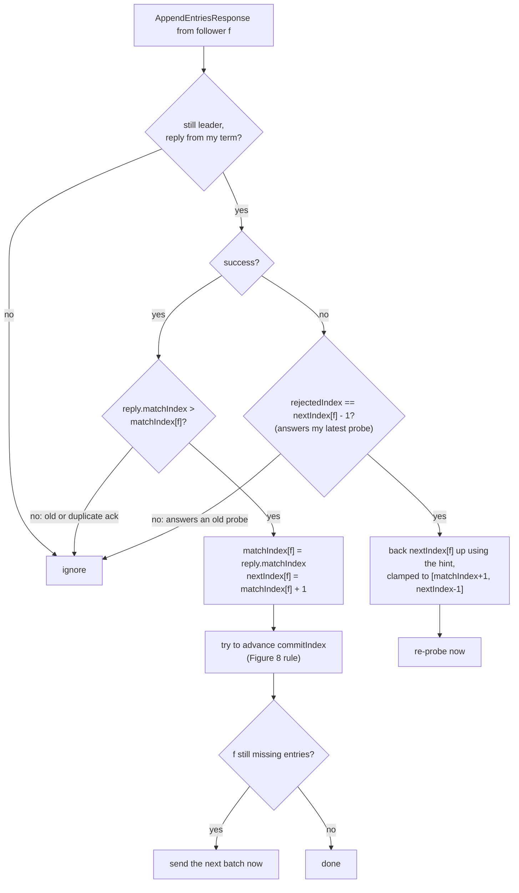
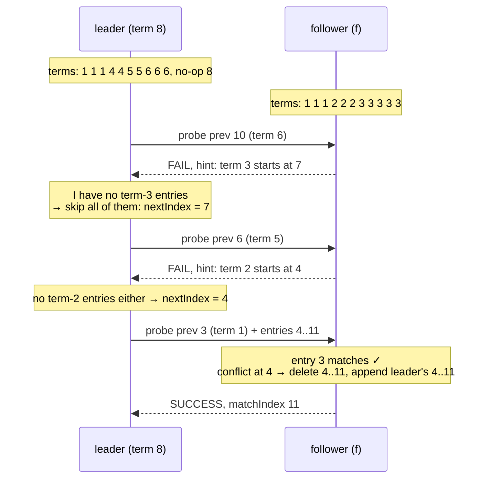
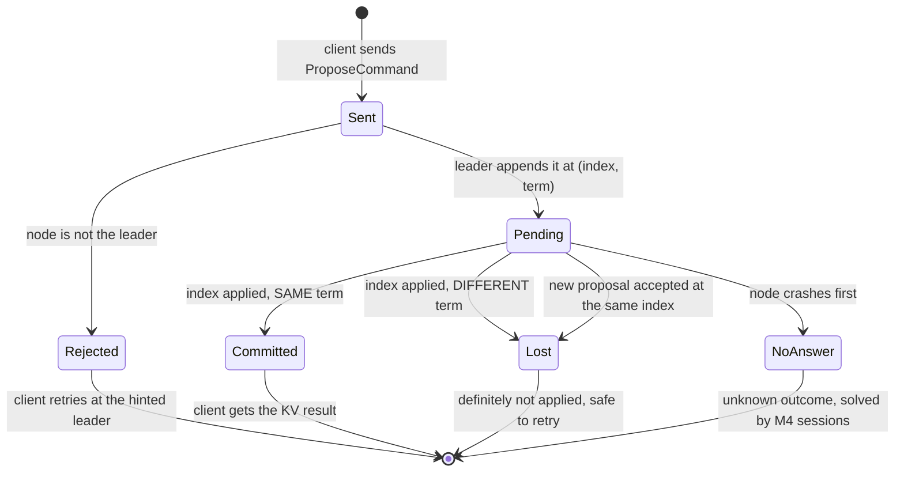
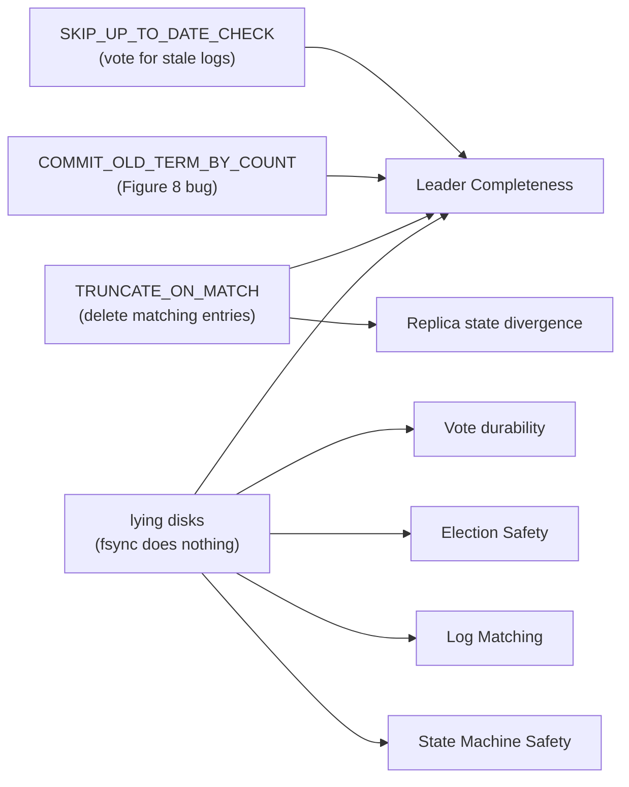

# Explanation: learning notes

These notes explain what was built in each milestone and why, so you can re-learn it later without
the original conversation. Each milestone gets its own section, added when that milestone is done.

Reference: *In Search of an Understandable Consensus Algorithm (Extended Version)*, Ongaro &
Ousterhout, 2014 (written "§5.2" or "Figure 2" below), plus Ongaro's PhD thesis (written "thesis §6.4").

**About the diagrams:** flow, sequence and state diagrams use [Mermaid](https://mermaid.js.org), which
GitHub renders automatically. In IntelliJ, enable it under Settings → Languages & Frameworks → Markdown
→ Markdown Extensions → Mermaid. Diagrams of logs (rows of entries) are plain text so the columns line
up everywhere.

---

# M1: Leader Election

**Status:** done (2026-11-22). Election Safety held over 5,000 chaos seeds each on 3-node and 5-node
clusters.

## Contents
1. [The big picture](#1-the-big-picture)
2. [Project setup decisions](#2-project-setup-decisions)
3. [The two core design decisions (D1, E1)](#3-the-two-core-design-decisions-d1-e1)
4. [Raft leader election: concepts](#4-raft-leader-election-concepts)
5. [How the code implements it](#5-how-the-code-implements-it)
6. [The simulator](#6-the-simulator)
7. [Invariant checkers](#7-invariant-checkers)
8. [Mutation testing: proving the checkers work (seed 9 walkthrough)](#8-mutation-testing-proving-the-checkers-work)
9. [Tests written](#9-tests-written)
10. [Results](#10-results)
11. [Shortcuts taken and what M2 must fix](#11-shortcuts-taken-and-what-m2-must-fix)
12. [Study questions (with answers)](#12-study-questions-with-answers)
13. [Glossary](#13-glossary)

---

## 1. The big picture

We are building a **replicated key-value store**: several servers (3 or 5) that each keep a copy of the
same data. Any server can crash, and the network can lose, delay, duplicate or reorder messages, but
the cluster must keep behaving like **one correct server**. **Raft** is the consensus algorithm that
makes the copies agree.

Raft works by electing **one leader**. All writes go through the leader, which copies them to the
others. M1 builds only the election part: how servers agree on who the leader is.

### Architecture: strict layering

```
          client library (M4)
                 │
   ┌─────────────▼─────────────┐
   │        raft-node          │  driver: one thread, executes effects in order
   │   (NodeDriver)            │  persist + fsync → send → apply → notify
   └──┬──────────┬──────────┬──┘
      │          │          │
┌─────▼───┐ ┌────▼─────┐ ┌──▼──────────────┐
│ storage │ │transport │ │ statemachine    │
│ (disk)  │ │(network) │ │ (KV store, M2)  │
└─────────┘ └──────────┘ └─────────────────┘
      ▲ none of these are called by the core
┌─────┴─────────────────────────────────────┐
│ raft-core: PURE state machine             │
│ input: Event → output: Ready (effects)    │
│ no threads, no I/O, no clock, seeded RNG  │
└───────────────────────────────────────────┘
```

**Why a pure core?** If the core never touches a clock, the disk, the network or threads, then the same
inputs always produce the same outputs. That makes it **deterministic**, which means:
- unit tests are simple: feed events in, check the `Ready` that comes out;
- the simulator can run thousands of chaotic scenarios in seconds of virtual time, and any failure can
  be **replayed exactly** from its seed number.

The core gets time only as `Tick` events (one tick = 10 ms in the simulator) and gets randomness only
from a `RandomGenerator` passed in at construction (seeded in tests).

### The 7 Gradle modules

| Module | What lives there | Depends on |
|---|---|---|
| `raft-core` | Raft rules, message/event/effect types | nothing |
| `raft-storage` | `Storage` interface, `InMemoryStorage` (file WAL in M3) | core |
| `raft-transport` | `Transport` interface (gRPC in M5) | core |
| `raft-statemachine` | KV store + client session table (M2/M4) | core |
| `raft-node` | `NodeDriver`: runs the core and executes its effects | core, storage, transport, statemachine |
| `raft-client` | client library (M4) | transport |
| `raft-sim` | deterministic simulator, fault injection, invariant checkers | all of the above |

Separate Gradle modules (instead of packages in one module) mean **the compiler enforces the layering**:
`raft-core` physically cannot import storage or gRPC code.

---

## 2. Project setup decisions

### Why the Spring Initializr scaffold was removed
The original project was generated by Spring Initializr with about 62 dependencies and a compose file
starting 12 databases. Problems:
1. The only test (`contextLoads`) started a dozen Docker containers through Testcontainers, so every
   test run needed Docker and took minutes, which is fatal for running 1,000+ simulation seeds.
2. Spring Boot auto-configures JPA, Mongo, Cassandra and so on, so the app crashes on startup without
   those databases.
3. The brief says plain Java, no Spring. Spring would also hide the threading and event loop we want to
   learn.
4. Lombok generates hidden code; records do the same job visibly.
5. A single module can't enforce layering.
6. Unused build plugins (Hibernate, GraalVM, GraphQL codegen, Asciidoctor) slow the build and can break it.

### Java 21 (not 17)
The brief said Java 17, and you chose 21. Java 21 has **pattern-matching `switch` over sealed types**, so:
```java
switch (event) {
    case Event.Tick t -> onTick();
    case Event.MessageReceived(Message m) -> onMessage(m);
    ...
}
```
If a new event type is added later, **every such switch stops compiling** until it handles the new
case. That's the "exhaustive switch" rule from the brief. In Java 17 this was only a preview feature.

### compose.yaml
The Raft store *is* the database (each node keeps its own write-ahead log on disk), so no external
database is needed. `compose.yaml` defines a **3-node cluster of our own nodes** for M5 real-process
tests:
- each node has its **own named volume** (bind mounts on macOS can weaken fsync guarantees);
- `restart: "no"`, so a crash test decides when a node comes back;
- `docker compose kill node2` sends SIGKILL, the same as `kill -9`.

It can't run until M5 adds the node's `main` class, gRPC and a Dockerfile.

---

## 3. The two core design decisions (D1, E1)

Full text is in `DESIGN.md`.

### D1: each node persists its own state; the core keeps an in-memory copy of the log
Each node saves to its own disk:
- **hard state**: `currentTerm` and `votedFor` (who it voted for in that term)
- **log entries**
- **snapshots** of the state machine (from M3)

On restart, `Storage.loadAll()` returns everything, and the core is rebuilt from it. While running, the
core reads only its **in-memory copy** of the log, never the disk. Storage is write-only until the next
restart.

*Rejected alternative:* the core reads the log from storage on demand (as etcd does). It uses less
memory but puts I/O inside the pure core.

### E1: `step(event)` returns a `Ready`, and the driver executes it before the next event
```
event ──► core.step(event) ──► Ready { persist, messages, toApply, notices, softState }
                                  │
              driver executes, IN THIS ORDER:
              1. persist all ops, then ONE fsync
              2. send messages
              3. apply committed entries to the state machine   (M2)
              4. notify waiting clients                          (M4)
```
The core has **already updated its memory** as if the `Ready` were done. That's safe only because the
driver is **single-threaded** and won't call `step()` again until the `Ready` is fully executed.

*Rejected alternative:* etcd's `Ready()`/`Advance()` handshake. It is more flexible (it can send while
an fsync is still in progress), but it has more states and more ways to misuse it.

### D1a: snapshot boundary rules (needed in M3)
- Compact the log only up to `lastApplied` (applied means committed, so nothing needed is thrown away).
- `termAt(snapshotIndex)` returns `snapshotTerm`, so the AppendEntries consistency check still works at
  the boundary.
- A follower receiving `prevLogIndex < snapshotIndex` has received a **stale** message, not a conflict.
  It skips the entries it already has and **never truncates below the snapshot**.
- A leader whose follower needs entries that were compacted away sends **InstallSnapshot**.
- InstallSnapshot handling follows Figure 13: ignore stale snapshots, keep the log suffix if it matches,
  otherwise discard the log.

### E1a: driver rules
1. **One mailbox:** network threads and timers only enqueue events. Nothing calls the core directly.
2. **A failed fsync stops the node** (fail-stop). Don't just "skip sending and carry on", because:
   - the core's memory already says the vote is saved, so memory and disk now disagree;
   - on Linux, after a failed fsync the OS may drop the unwritten data, and a later fsync can report
     success anyway ("fsyncgate", PostgreSQL 2018).

   The only safe recovery is to crash and reload from what is really on disk.
3. **Every message waits for the fsync**, even heartbeats.
4. **Deterministic state machine:** no clock, no randomness, sorted (canonical) snapshot serialization.
   Then two nodes at the same `lastApplied` produce byte-identical snapshots.
5. **Snapshots are taken at exactly `lastApplied`,** between two `Ready`s.

---

## 4. Raft leader election: concepts

### 4.1 Which algorithm?
Not a separate choice: this is **Raft's own leader election (§5.2)**, not Bully, Ring or Paxos. Its
ingredients are:
- **terms** (a logical clock),
- **randomized election timeouts**,
- **majority voting**,
- **one vote per node per term, first come first served**,
- the **election restriction** (§5.4.1): a node won't vote for a candidate whose log is behind its own.

PreVote (M5) is an *extension* of Raft, not a different algorithm.

### 4.2 Terms
A **term** is a number that only goes up. It acts as a **logical clock**:
- each term starts with an election;
- each term has **at most one leader** (or none, if the vote split);
- every message carries the sender's term.

**The term rule (§5.1, Figure 2 "All Servers"):** if a node sees any message with a term **higher** than
its own, it:
1. sets `currentTerm` to that term,
2. clears `votedFor` (a new term means a fresh vote),
3. becomes a **follower**.

A message with a **lower** term is stale. It gets rejected (and the reply carries the current term, so
the sender learns it's behind) or ignored.

### 4.3 Roles
```
             timeout, start election
 ┌──────────┐ ─────────────────────► ┌───────────┐  wins majority  ┌────────┐
 │ FOLLOWER │                        │ CANDIDATE │ ──────────────► │ LEADER │
 └──────────┘ ◄───────────────────── └───────────┘                 └────────┘
      ▲   sees higher term, or a leader     │ timeout again:            │
      │   of its own term                   └─► new election,           │
      │                                         term + 1                │
      └──────────────────── sees higher term ───────────────────────────┘
```

### 4.4 An election, step by step
1. A follower hears nothing from a leader for its **election timeout** (random, 100–190 ms here).
2. It becomes a **candidate**:
   - `currentTerm += 1`
   - `votedFor = self`
   - **persist both to disk (fsync)**
   - reset its election timer with a new random timeout
   - send `RequestVote(term, lastLogIndex, lastLogTerm)` to every other node
3. Each receiver decides whether to vote (rules in 4.5) and replies `RequestVoteResponse(term, granted)`.
4. If the candidate collects votes from a **majority** (2 of 3, or 3 of 5, counting itself), it becomes
   **leader** and immediately sends heartbeats.
5. If it hears from a valid leader of its term, or sees a higher term, it becomes a follower.
6. If its timer fires again with no winner (a **split vote**), it starts a new election in term + 1.

**The same election as a message diagram** (3 nodes; n1's timer fires first):



### 4.5 Voting rules (Figure 2, RequestVote receiver)
A node grants its vote only if **all three** hold:
1. **Term OK:** the request's term equals its `currentTerm` (after applying the term rule: a higher
   term was already adopted, and a lower one means reject).
2. **Hasn't voted for someone else:** `votedFor` is empty or already this candidate.
3. **Candidate's log is at least as up to date** (§5.4.1). Compare the **last entries**:
   - higher last term wins;
   - with the same last term, the longer (or equal) log wins.

Granting a vote means: set `votedFor = candidate`, **persist it before replying**, and reset the
election timer.

Examples (my log vs. the candidate's):

| My log (last term, length) | Candidate (last term, length) | Grant? | Why |
|---|---|---|---|
| (3, 2) | (2, 5) | ❌ | candidate's last term is lower, so length doesn't matter |
| (3, 3) | (3, 2) | ❌ | same last term but the candidate is shorter |
| (1, 3) | (2, 1) | ✅ | candidate's last term is higher, even though it's shorter |

**Why rule 3 exists:** it guarantees a new leader already has every committed entry (Leader
Completeness, §5.4). M1 logs stay empty during simulation, so this rule only gets real chaos coverage
in M2.

### 4.6 Why two leaders in the same term are impossible
- A leader needs a **majority** of votes.
- Any two majorities of the same cluster **overlap** in at least one node. With 3 nodes, two groups of 2
  must share someone.
- That shared node **votes only once per term**.
- So two candidates can't both get a majority **in the same term**.

This depends on the vote being **durable**. A node that forgets its vote after a crash can vote twice,
and then two leaders become possible (shown for real in section 8).

### 4.7 Duplicate votes: how we detect and handle them
The network can duplicate messages. There are two places this matters, and neither needs message IDs.

**(a) The candidate receives the same "yes" twice.**
- Votes are stored as a **`Set<NodeId>` of voters**, not a counter (`RoleState.Candidate.withVote`).
- Each response carries `from` (the voter's ID). Adding node 2 twice still leaves one entry.
- With a counter, `votes++` twice would count one node as two votes. With 3 nodes, that would wrongly
  make the candidate leader.
- A response also counts **only if its term equals the candidate's current term**, so a "yes" from an
  earlier election can't be reused.

**(b) The voter receives the same request twice.**

| `votedFor` | Action |
|---|---|
| empty | grant, and persist `votedFor = candidate` |
| this same candidate | grant again (a harmless repeat, nothing new to persist) |
| a different node | refuse |

So "is this a duplicate?" means: is the voter already in the set (candidate side), or does `votedFor`
already name this candidate (voter side)?

### 4.8 Stepping down: three situations
"A higher term makes the candidate step down" does **not** mean two winners compare terms. It means any
node that sees a higher term knows it's out of date.

**A. An outdated candidate.**
1. n1 and n3 both time out. n1 starts term 5, but its messages are delayed.
2. n3's timer fires again, so it starts term 6 and wins with votes from n2 and itself.
3. n1, still a term-5 candidate, gets n3's heartbeat stamped **term 6**.
4. n1 adopts term 6 and becomes a follower.

**B. Someone else won the same term.** n1 and n2 both run in term 5, and n2 wins. n2's term-5
heartbeat reaches n1, so n1 steps down (§5.2). Its vote for itself in term 5 stays recorded.

**C. A deposed leader.** Old leader n1 is partitioned. The others elect n2 in term 8. When the partition
heals, n1 sees a term-8 message and steps down. This is why a paused or partitioned old leader can't
keep acting as leader once it's back in contact.

### 4.9 The election timer
- It's a **tick counter**, not a clock. The driver sends a `Tick` event every 10 ms (virtual time in the
  simulator).
- Each follower or candidate has `electionElapsed` and `randomizedElectionTimeout`, a random value in
  `[T, 2T)` = 10..19 ticks = 100–190 ms.
- On each tick: `electionElapsed++`. When it reaches the timeout, start an election.

**Reset rule** (set the counter to 0 and draw a NEW random timeout). This happens only when the node:
1. receives a **valid heartbeat from the current leader**,
2. **grants a vote**,
3. **starts its own election**, or
4. **was leader and steps down** (its election timer wasn't running while it was leader, so it needs
   a fresh one).

**Never** on a stale or rejected message. Otherwise an old leader's delayed messages could stop the
cluster from replacing it.

**Leaders don't run an election timer.** They run a **heartbeat timer**: every 2 ticks (20 ms), send an
empty AppendEntries to everyone.

**When is a new leader chosen? Only when followers stop hearing from the leader, never on a schedule.**
While heartbeats arrive every 20 ms, followers keep resetting their 100–190 ms timers and never time out.
A healthy leader stays leader indefinitely. The quiet-cluster test confirms that leadership never changes
once a leader is elected. Elections happen when the leader crashes, is partitioned, is paused (for
example by garbage collection), or when enough heartbeats are lost or delayed.

**Why random?** If everyone used exactly 150 ms, they'd all become candidates at the same moment, split
the votes, and repeat forever. With random timeouts, one node usually fires first and wins before the
others wake up.

**Why a new random value on every reset (not once per term)?** Two nodes that timed out together once
are then unlikely to collide again. This is what etcd does, and it fits §5.2.

### 4.10 Persistence and fsync
- `write()` puts data into the **operating system's in-memory page cache**. It looks saved, but a power
  loss or machine crash wipes it.
- `fsync()` forces the cache to the **physical disk** and returns only once the data is really there.
- **fsync is an operation, not data.** What is stored is `currentTerm`, `votedFor` and log entries.
  fsync is how we make sure they're on disk **before** we tell anyone about them.

**Why it matters:** if a node replies "yes, I vote for you", crashes before the fsync, and restarts
without the vote, it can vote again in the same term. That's two leaders.

In the code:
- `Storage.sync()` is fsync. The driver always does: write ops → `sync()` → send.
- `InMemoryStorage` simulates it with a "working" copy and a "durable" copy. `sync()` copies working
  into durable, and `crash()` throws the working copy away.
- M3's file storage will call `FileChannel.force()`, Java's fsync.

**Nuance:** if only the *process* is killed (`kill -9`), the OS still holds the written data and flushes
it later. The data is lost only if the *machine* crashes or loses power. The simulator models the worst
case.

---

## 5. How the code implements it

### 5.1 The types (`raft-core`)

| Type | What it is |
|---|---|
| `NodeId(int)` | a node's identity |
| `HardState(currentTerm, votedFor)` | the persistent part of Figure 2 (excluding the log) |
| `LogEntry(index, term, payload)` | one log entry. Payload is `Noop` or `Command(Bytes)` |
| `Bytes` | an immutable byte string that compares **by content**. A record holding a raw `byte[]` compares by reference, which would silently break log comparisons. |
| `PersistentState(hardState, entries)` | what storage returns on restart. Validates that the log is contiguous from 1, terms never decrease, and no entry's term exceeds `currentTerm`. |
| `Message` (sealed) | `RequestVote`, `RequestVoteResponse`, `AppendEntries`, `AppendEntriesResponse` |
| `Event` (sealed) | `Tick`, `MessageReceived`, `ProposeCommand`, `ReadRequested` |
| `PersistOp` (sealed) | `SaveHardState`, `TruncateSuffix`, `AppendEntries`: an **ordered list**, so several Readys can share one fsync (group commit, M6) |
| `ClientNotice` (sealed) | proposal accepted/rejected, read ready/rejected (M2/M4) |
| `Ready` | the effects of one step, executed in order: persist → messages → toApply → notices |
| `SoftState(role, term, leader)` | the volatile observable state, emitted only when it changes |
| `RaftConfig` | self, members (3 or 5), election timeout ticks, heartbeat ticks. Validates `election > 2 × heartbeat`. |
| `RaftCore` | interface: `step(Event) → Ready`, `status()`, `log()` |

### 5.2 `RoleState`: one object per role
```java
sealed interface RoleState {
    record Follower(Optional<NodeId> leader)  implements RoleState {}
    record Candidate(Set<NodeId> votes)       implements RoleState {}
    record Leader()                           implements RoleState {}  // M2 adds per-peer progress
}
```
Changing role **replaces the whole object**, so a new leader can't inherit stale votes, and a follower
can't keep stale leader-only fields. The rejected alternative (one class with a role enum and all fields
side by side) needs manual resets on every transition, and forgetting one is a classic Raft bug.

### 5.3 `RaftNodeCore`: the rules
| Method | Rule |
|---|---|
| `tickElection` | count ticks; when the timeout is reached, `startElection` |
| `tickHeartbeat` | leader: every `heartbeatIntervalTicks`, broadcast heartbeats |
| `resetElectionTimer` | counter = 0, new random timeout in `[T, 2T)` |
| `startElection` | term + 1, vote for self, become candidate, reset timer, send RequestVote |
| `becomeLeader` | become leader, send heartbeats immediately |
| `onMessage` | validates `to == self` and the sender is a member; applies the term rule; dispatches |
| `stepDownToHigherTerm` | adopt the term, clear the vote, become follower; only a former leader gets a fresh timer |
| `onRequestVote` | the three voting rules; persist the vote; reset the timer only when granting |
| `onRequestVoteResponse` | only as candidate, only for the current term, only "yes"; add to the set; check majority |
| `onAppendEntries` | stale term → reject, no timer reset. Same term: candidate steps down; a follower records the leader; the timer resets; the prevLog check runs |
| `drainReady` | builds the `Ready`, including `SaveHardState` **only if** the term or vote changed in this step |

**Built-in safety alarms:** if a leader receives AppendEntries from another node in its own term, or a
follower sees two different leaders in one term, the core throws `IllegalStateException("Election Safety
violated ...")`. It fails loudly instead of continuing in a broken state.

### 5.4 `NodeDriver` (`raft-node`)
```java
Ready r = core.step(event);
if (r.mustSync()) { for (op : r.persist()) persist(op); storage.sync(); }  // a failure here: halt
for (m : r.messages()) transport.send(m);
```
- If `sync()` throws a `StorageException`, the driver marks itself **halted**, sends nothing, and every
  later `handle()` throws `NodeHaltedException`. The node must be restarted from disk.
- `NodeDriver.recover(config, storage, transport, rng)` builds a node from whatever is durable, which
  covers both a fresh start and crash recovery.
- It's synchronous. The real multi-threaded event loop comes with gRPC in M5.

---

## 6. The simulator

`raft-sim/.../Simulation.java` is a **discrete-event simulation**:
- **Virtual time:** a priority queue of events ordered by `(time, sequence number)`. The sequence number
  breaks ties deterministically. No real sleeping happens, so a 13-second scenario takes milliseconds.
- **Real code under test:** each node runs the real `NodeDriver` over an `InMemoryStorage`, so the
  driver's persist-then-send order is actually tested.
- **Seeds:** one seed is split into independent random streams for the network, the faults and the
  nodes. **Same seed means the identical run**, which is checked by comparing a hash over every event.

**One simulated run, as a loop:**



### Network model (`NetworkConfig.chaotic()`)
| Behaviour | Value |
|---|---|
| normal delay | uniform 1–10 ms (different delays reorder messages naturally) |
| long delay | 1% of messages are delayed 10–50× (up to 500 ms), which delivers very stale messages from old terms |
| drop | 5% |
| duplicate | 2% |
| partitions | **directed** links, so one-way partitions are possible |

### Fault schedule (`FaultConfig.chaos()`)
Every 100–600 ms during the 10-second chaos phase, one random fault is injected:
- **symmetric partition:** split the nodes into two groups that can't talk;
- **one-way partition:** block 1–2 directed links (A can send to B, but B can't send to A);
- **heal:** remove all link blocks;
- **crash:** power loss (unsynced data lost); restart after 100–2,000 ms;
- **pause:** freeze a node for 100–800 ms, like a long garbage-collection pause. Messages to it queue up
  and are delivered when it resumes, and it gets no ticks while frozen.

Then a 3-second **quiet phase**: links healed, all nodes up (network loss and delay continue). The
**liveness check** requires a current-term leader within the last 1 second of the run.

### Commands
```
./gradlew build                                  # everything (300 seeds per chaos test)
./gradlew :raft-sim:test -Psim.seeds=5000        # the milestone gate
./gradlew :raft-sim:test -Psim.seed=1234         # replay one seed
```
A failing run prints its **seed**, the **replay command**, the config and the **last 300 events**.

---

## 7. Invariant checkers

Both run after **every** event, on every node, after the fsync.

### `ElectionSafetyChecker`: invariant 1
- Keeps a map `term → leader` for the **whole run**.
- If a second, different node is ever leader of a term already in the map, it fails.
- It remembers history, not just current leaders, because the first leader may have stepped down long
  ago (see seed 9 in section 8).

### `VoteDurabilityChecker`: the precondition of invariant 1
A detector for **forgotten promises**. For each node it remembers the last `(currentTerm, votedFor)` it
saw, and fails if:
1. **the term goes backwards**, or
2. **the vote changes within the same term** (including back to "no vote").

| Before → After | Allowed? |
|---|---|
| term 5, no vote → term 5, voted n2 | ✅ first vote in the term |
| term 5, voted n2 → term 5, voted n2 | ✅ unchanged |
| term 5, voted n2 → term 6, no vote | ✅ new term, so a fresh vote |
| term 5, voted n2 → term 5, **voted n3** | ❌ voted twice |
| term 5, voted n2 → term 5, **no vote** | ❌ forgot the vote |
| term 5 → **term 4** | ❌ term went backwards |

A restarted node is checked as soon as it starts, so a lost vote is caught **at the first restart**,
before it causes any harm.

---

## 8. Mutation testing: proving the checkers work

A checker that never fails might just be broken. So we **break the system on purpose** and confirm the
checkers notice.

**The injected bug:** `SimConfig.withLyingDisks()` makes `InMemoryStorage.sync()` report success
**without saving anything**, like a disk with a volatile write cache. After a crash, a node comes back
with **term 0 and no vote**.

### Level 1: the cause (vote checker on)
Measured over 50 seeds: **50 of 50 caught**, on average **2.6 seconds** in (usually the first restart).
Seed 9:
```
Vote durability violated at t=2195ms: n1 term went backwards 1 -> 0
    2195ms n1   start #2 HardState[currentTerm=0, votedFor=Optional.empty]
```

### Level 2: the consequence (vote checker off)
This proves the bug really produces two leaders. It happened in **70 of 500 seeds**. Seed 9 again:

| Time | Event | Meaning |
|---|---|---|
| ~0 ms | n1 wins **term 1** | checker records `term 1 → n1` |
| 9,619 ms | n1 paused | n1 is at term 28 but frozen and can't tell anyone |
| 9,673 ms | `n2 start #4 HardState[currentTerm=0, votedFor=empty]` | n2's disk lied, so its terms and votes are gone |
| 9,835 ms | `n3 start #2 HardState[currentTerm=0, ...]` | n3's too |
| 9,929 ms | `n3 -> CANDIDATE term=1` | 0 + 1 = 1, so n3 **reuses term 1** |
| 9,944 ms | n2 votes for n3 in term 1 | n2 has forgotten it already voted in term 1 |
| 9,948 ms | n3 has 2/3 → `LEADER term=1` | **"Election Safety violated: term 1 has leaders n1 and n3"** |

- **Why it's a real bug:** two leaders in one term, each backed by a majority, means some node voted
  twice. In M2, two same-term leaders could write different entries at the same index with the same
  term, which breaks Log Matching, and nodes would diverge.
- **Why history matters:** at 9,948 ms, n1 hadn't been term 1's leader for about 10 seconds. A checker
  that only compared *current* leaders would see a single leader and pass.
- **Why the core's own alarm didn't fire:** no single node heard from both leaders.

### Why both checkers
| | Catches | Seeds failing |
|---|---|---|
| vote checker | the cause, early, at the first restart | 50/50 |
| Election Safety checker | the consequence, rarely and late | 70/500 |

**No false alarms with correct disks:** both checkers look only after the fsync, and `crash()` keeps the
durable copy, so a correctly restarted node comes back with exactly its last term and vote. Hence
10,000 clean runs (5,000 seeds × 2 cluster sizes) with zero violations.

`MutationSanityTest` asserts both levels.

---

## 9. Tests written

Tests were written **before** the implementation.

| File | Covers |
|---|---|
| `ElectionTimerTest` | election fires within `[T, 2T)` (jqwik property over random seeds); starting an election persists term and self-vote before RequestVote; split vote leads to term + 1; idle ticks emit nothing; same seed gives identical Readys |
| `RequestVoteTest` | stale term rejected; vote once per term; duplicate request re-granted without re-persisting; the 3 log-comparison cases; higher term adopted even when the vote is refused; timer reset only on a grant; recovered vote honoured; leader refuses votes in its own term |
| `CandidateTest` | majority leads to leader plus immediate heartbeats; duplicate vote counted once; vote from an earlier term ignored; higher term causes step-down; same-term AppendEntries causes step-down while keeping the vote |
| `LeaderAndFollowerTest` | heartbeat schedule; leader steps down on a higher term with a fresh timer; heartbeat resets a follower's timer; stale heartbeat doesn't; stale responses ignored; two leaders in one term throws; wrong destination throws; proposals throw until M2 |
| `RaftConfigTest`, `PersistentStateTest`, `BytesTest`, `ReadyTest` | value-type validation |
| `InMemoryStorageTest` | synced data survives a crash, unsynced data doesn't, failed sync, lying fsync |
| `NodeDriverTest` | the order is exactly saveHardState → sync → send; a failed sync sends nothing and halts |
| `ElectionSafetyCheckerTest`, `VoteDurabilityCheckerTest` | the checkers themselves |
| `SimulationDeterminismTest` | same seed gives an equal result, including the event hash |
| `QuietClusterElectionTest` | reliable network: leader within 1 s, never changes afterwards |
| `ElectionChaosTest` | **the M1 gate** |
| `MutationSanityTest` | lying disks are caught at both levels |

69 tests in total.

---

## 10. Results

| Run | Result |
|---|---|
| Chaos gate, 3 nodes, 5,000 seeds | 0 violations: 40,705 elections, ~56k partitions, ~28k crashes, ~26k pauses, highest term 58 |
| Chaos gate, 5 nodes, 5,000 seeds | 0 violations: 41,944 elections, highest term 69 |
| Runtime of the gate | ~18 s for both cluster sizes together |
| Quiet cluster | every seed: leader within 1 s, never changed afterwards |
| Liveness after heal | every chaos run |
| Mutation (lying disks) | vote checker 50/50; two-leader outcome 70/500 |

**Why terms reach 58–69:** there is no PreVote yet (M5). A node returning from a partition with a higher
term forces the current leader to step down.

---

## 11. Shortcuts taken and what M2 must fix

All are marked `// SHORTCUT:` in the code and listed in `DEVIATIONS.md`. The full checklist is in
`MILESTONES.md`.

| # | Shortcut | Why acceptable in M1 |
|---|---|---|
| P1 | heartbeats always send `prevLogIndex = 0` and no entries | valid under Figure 2 (index 0 always matches), but nothing is replicated |
| P2 | a new leader doesn't append a no-op entry (§8) | nothing commits in M1 |
| P3 | proposals, reads and non-empty AppendEntries **throw** | fail loudly instead of being silently ignored |
| — | the driver throws if asked to apply entries | the state machine arrives in M2 |

M2 also adds checkers for **Log Matching, Leader Completeness, State Machine Safety and Leader
Append-Only**, each as its own class, plus mutations that must be caught (skipping the log up-to-date
check; committing old-term entries, the Figure 8 bug).

---

## 12. Study questions (with answers)

Try each one before reading the answer.

**Q1. In `stepDownToHigherTerm`, why does only a former leader get a fresh election timer? What goes
wrong if every higher-term message reset a follower's timer?**
<details><summary>Answer</summary>

A leader doesn't run an election timer, so when it becomes a follower it must start one, and it starts
from 0. A follower or candidate already has a running timer, and a higher term alone is **not** proof
that a live leader exists.

If higher-term messages reset timers, imagine a node with a stale log. It keeps timing out and sending
RequestVote with ever-higher terms, and it can never win, because the log check makes everyone refuse
it. Each request would reset everyone else's timer, so nobody else would ever time out and run an
election. The cluster would stay leaderless for as long as the loser keeps trying. That's a **liveness**
failure.
</details>

**Q2. With lying disks, trace a failing seed by hand: find the node that voted twice and the crash that
made it forget.**
<details><summary>Hint</summary>

Run seed 9 (section 8). At 9,944 ms n2 votes for n3 in term 1. Find who voted for n1 in term 1 at the
start of the run. The 300-event trace window is too short to show it, so temporarily raise
`new Trace(300)` in `Simulation.java`. Then find the crash/restart after which that node came back
with `currentTerm=0`.
</details>

**Q3. Why does the Election Safety checker keep every term's leader for the whole run? Give a schedule
that a "current leaders only" checker would miss.**
<details><summary>Answer</summary>

Seed 9: n1 led term 1 near t=0, and by 9,948 ms it was a paused node at term 28. n3 then became leader
of term 1. At that moment only one node calls itself leader, so a current-only checker passes. The
violation exists only in history.
</details>

**Q4. Why do randomized timeouts affect only liveness, never safety? Check that nothing in
`RaftNodeCore`'s safety logic reads `electionElapsed`.**
<details><summary>Answer</summary>

The safety argument uses only: votes are once per term, votes are durable, and majorities overlap.
Timeouts only decide **when** an election starts. Bad timing can cause more elections (more terms) or a
period with no leader, but each term still has at most one leader.

In the code, `electionElapsed` and `randomizedElectionTimeout` are read only in `tickElection` (to
decide whether to start an election) and written only in `resetElectionTimer`. The vote-granting and
leader-decision code never reads them (verify with
`grep -n electionElapsed raft-core/src/main/java/com/projects/raftkv/core/RaftNodeCore.java`).
</details>

**Q5 (from setup). Why does `ProposalAccepted(index, term)` not mean "committed"?**
<details><summary>Answer</summary>

The leader may crash before replicating the entry. A new leader can then overwrite that index with a
different entry (Figure 8, §5.4.2). So at apply time the driver must check that the entry at `index`
still has `term`. If it doesn't, the proposal was lost and the client must retry. Client sessions (M4)
make that retry safe.
</details>

**Q6. Why isn't `commitIndex` in `HardState`?**
<details><summary>Answer</summary>

Figure 2 marks it as volatile. After a restart a node starts at 0 and learns the real commit index from
the leader's next AppendEntries (`leaderCommit`). It loses nothing that matters, because committed
entries are on a majority's disks, and it re-applies them, so the state machine is rebuilt
deterministically (or restored from a snapshot from M3 on).
</details>

---

## 13. Glossary

| Term | Meaning |
|---|---|
| **term** | a monotonically increasing election number; a logical clock |
| **quorum / majority** | ⌊n/2⌋ + 1 nodes: 2 of 3, 3 of 5 |
| **heartbeat** | an empty AppendEntries sent by the leader to suppress elections |
| **election timeout** | how long a follower waits without leader contact before running; random in [T, 2T) |
| **split vote** | no candidate reaches a majority; a new election follows in term + 1 |
| **hard state** | `currentTerm` + `votedFor`: must survive crashes |
| **soft state** | role, leader, term as observed now; volatile |
| **fsync** | the OS call that forces written data onto the physical disk |
| **fail-stop** | on an unrecoverable error, stop completely rather than continue in an unknown state |
| **Ready** | the list of effects one core step produces; executed in a fixed order |
| **deterministic simulation** | virtual time + seeded randomness: the same seed gives the same run |
| **invariant** | a property that must hold in every reachable state |
| **mutation test** | deliberately break the system to prove the tests can detect it |
| **liveness vs. safety** | liveness = something good eventually happens (a leader gets elected); safety = nothing bad ever happens (never two leaders). Raft's safety never depends on timing. |

---

# M2: Log Replication

**Status:** done (gate passed 2026-11-22, accepted 2026-11-23). Invariants 1–5 held over 5,000 chaos
seeds each on 3-node and 5-node clusters, with clients proposing commands the whole time. Every
deliberately broken rule was caught.

## Contents
1. [What M2 adds, in one picture](#m2-1-what-m2-adds-in-one-picture)
2. [The decisions you approved (M2-A to M2-E)](#m2-2-the-decisions-you-approved)
3. [The four new invariants and why Raft guarantees them](#m2-3-the-four-new-invariants)
4. [The follower side: AppendEntries receiver](#m2-4-the-follower-side)
5. [The leader side: nextIndex, matchIndex, commit](#m2-5-the-leader-side)
6. [Figure 8: why a leader can't commit old entries by counting](#m2-6-figure-8)
7. [Fast log backup](#m2-7-fast-log-backup)
8. [The apply path: state machine, codec, driver](#m2-8-the-apply-path)
9. [Simulator changes: clients, log tracking, checkers](#m2-9-simulator-changes)
10. [Mutation testing in M2](#m2-10-mutation-testing-in-m2)
11. [Tests written](#m2-11-tests-written)
12. [Results](#m2-12-results)
13. [Shortcuts and what is left for later](#m2-13-shortcuts-and-what-is-left)
14. [Study questions (with answers)](#m2-14-study-questions)
15. [Glossary additions](#m2-15-glossary-additions)

---

<a id="m2-1-what-m2-adds-in-one-picture"></a>
## 1. What M2 adds, in one picture

In M1 a leader got elected and then did nothing. In M2 it does the job Raft exists for: it turns client
commands into log entries, copies them to the followers, decides when an entry is **committed** (stored
on a majority, so it can never be lost or replaced), and every node applies committed entries, in index
order, to the key-value store. The goal: under all the chaos from M1, every node ends up with the same
KV data.

```
client ──Propose(cmd)──► LEADER (term 3)
                           1. append (index=8, term=3) to its own log
                           2. persist + fsync               (E1: before anything is sent)
                           3. AppendEntries(prevLogIndex=7, prevLogTerm=3, entries=[8], leaderCommit=7)
                                                                           │ to each follower
FOLLOWER                                                                   ▼
  4. "do I have entry 7 with term 3?"
       no  → reply fail + hint (the leader backs up and retries)
       yes → append 8, persist + fsync, reply success(matchIndex=8)
LEADER
  5. matchIndex[f] = max(old, 8)
  6. a majority has matchIndex ≥ 8 AND log[8].term == currentTerm  → commitIndex = 8
  7. apply entry 8 to the KV store → answer the client
  8. the next AppendEntries carries leaderCommit=8 → followers commit and apply 8 too
```

The same flow as a message diagram:



**Where the indexes sit**, for a 3-node cluster in the middle of replication:

```
index:          1     2     3     4     5     6     7     8
leader n1     [t1]  [t1]  [t2]  [t2]  [t3]  [t3]  [t3]  [t3]    lastIndex = 8
follower n2   [t1]  [t1]  [t2]  [t2]  [t3]  [t3]  [t3]  [t3]    matchIndex = 8, nextIndex = 9
follower n3   [t1]  [t1]  [t2]  [t2]  [t3]                      matchIndex = 5, nextIndex = 6
                                                          ▲
                              commitIndex = 8 on n1: n1 + n2 = 2 of 3 have it
              ◄──────────── applied to the KV store (lastApplied = 8) ────────────►
```

Two words you'll see everywhere:
- **commitIndex**: the highest index known to be committed. Volatile: it restarts at 0 after a crash
  and is relearned from the leader.
- **lastApplied**: the highest index applied to the state machine. Also volatile. After a restart the KV
  store is rebuilt by re-applying the log from index 1 (snapshots arrive in M3).

---

<a id="m2-2-the-decisions-you-approved"></a>
## 2. The decisions you approved (M2-A to M2-E)

They're recorded in `DESIGN.md`. In short:

| # | Decision | Why | Rejected |
|---|---|---|---|
| M2-A | The leader sends AppendEntries **on every proposal and every heartbeat**. `nextIndex` moves **only when a reply arrives**. Up to `maxEntriesPerAppend` (64) entries per message. | Simple to reason about: there's no "in flight" state to rewind. | etcd-style pipelining: fast, but much more state and many edge cases. Heartbeat-only sending: adds up to 20 ms to every commit. |
| M2-B | A **hand-written binary codec** for commands. | No dependencies, canonical (one value has exactly one byte encoding), and every byte is visible. | Protobuf now (build complexity, not guaranteed canonical); Java serialization (unsafe, fragile). |
| M2-C | **Mutation hooks**: `RaftNodeCore.withMutationsForTesting(..., Set<ProtocolMutation>)`. | Each bug is one clearly marked `if` at the exact rule it breaks. | Subclass overrides (non-final classes, lint errors); PIT (slow, untargeted). |
| M2-D | **Open-loop simulated clients**: send every 20–100 ms, follow leader hints, never retry. | M2 checks that replicas agree. Checking what clients see is M4's job. | Retrying clients: without M4's dedup, a retry can execute a command twice. |
| M2-E | The **driver** matches proposals to results: it remembers `index → (proposalId, term)` and resolves the proposal when that index is applied. | The core stays pure, and the overwritten-proposal case is handled exactly. | Having the core track client futures. |

---

<a id="m2-3-the-four-new-invariants"></a>
## 3. The four new invariants and why Raft guarantees them

Invariant 1 (Election Safety) is from M1. M2 adds four more (Figure 3 of the paper):

| # | Invariant | In plain words | Why it holds |
|---|---|---|---|
| 2 | **Leader Append-Only** | A leader never deletes or overwrites entries in its own log. | The code gives leaders no path to truncate: they only call `appendAsLeader` (`RaftNodeCore.java:228`). Only followers truncate. |
| 3 | **Log Matching** | If two logs have an entry with the same index **and** term, the logs are identical up to that index. | (a) A leader creates at most one entry per index in its term, and terms are unique per leader (Election Safety). (b) The **consistency check**: a follower accepts entries only if its entry at `prevLogIndex` has `prevLogTerm`. By induction, accepting entry 8 means entries 1–7 already matched. |
| 4 | **Leader Completeness** | A committed entry is in the log of **every** future leader. | Committed means it's on a majority. Winning an election needs votes from a majority. The two majorities overlap in at least one node, and that node only votes for a candidate whose log is at least as up to date (§5.4.1, the M1 election restriction). This argument only works because of the Figure 8 commit rule (section 6). |
| 5 | **State Machine Safety** | No two nodes ever apply different entries at the same index. | Nodes apply only committed entries, in order. By 4, every later leader has the same committed prefix, and by 3 it copies that prefix exactly to everyone. |

Why does invariant 4 need the election restriction from M1? Without it, a node with an old, short log
could be elected and would then overwrite committed entries everywhere. The mutation test in section 10
shows exactly this happening when the check is removed: 97 of 100 seeds broke.

---

<a id="m2-4-the-follower-side"></a>
## 4. The follower side: AppendEntries receiver

Code: `onAppendEntries` (`RaftNodeCore.java:302`) and `mergeEntries` (`RaftNodeCore.java:350`).
Figure 2 lists five receiver steps:

1. **Reply false if `term < currentTerm`.** The sender is a stale leader. No timer reset: that's not
   valid leader contact (same as M1).
2. **Reply false if the log has no entry at `prevLogIndex` with term `prevLogTerm`.** This is the
   consistency check. A rejection still counts as leader contact (the timer resets and the follower
   learns the leader), because the sender really is the current leader.
3. **If an existing entry conflicts with a new one (same index, different term), delete it and
   everything after it.**
4. **Append any new entries not already in the log.**
5. **If `leaderCommit > commitIndex`, set `commitIndex = min(leaderCommit, index of last new entry)`.**

The whole receiver as a decision diagram:



### Rule 3's trap: truncate only on a real conflict
A naive implementation does "delete everything after `prevLogIndex`, then append the message's entries".
That's wrong, because messages can arrive **reordered**. Example:

```
follower log:       [1:t1, 2:t3, 3:t3, 4:t3]        (entries 2-4 arrived in one message)
a late, OLD message: prevLogIndex=1, entries=[2:t3]  (sent earlier, delayed by the network)

naive:   delete 2..4, append 2   →  [1:t1, 2:t3]       entries 3 and 4 are gone
correct: entry 2 already matches (same index, same term), nothing new → log unchanged
```

If entries 3 and 4 were already committed (the leader counted this follower's earlier ack), the naive
version just deleted committed data. As a timeline:

```mermaid
sequenceDiagram
    participant L as leader
    participant F as follower
    L->>F: AE-1: prev 1, entries [2]
    Note right of L: AE-1 gets stuck in the network
    L->>F: AE-2: prev 1, entries [2, 3, 4]
    F-->>L: success, matchIndex 4
    Note over L: entries 2-4 on a majority → committed
    Note over F: much later, the stale AE-1 finally arrives
    alt correct (§5.3): truncate only on a real conflict
        Note over F: entry 2 already matches → nothing to do<br/>log stays [1, 2, 3, 4] ✓
    else bug (TRUNCATE_ON_MATCH): replace everything after prevLogIndex
        Note over F: delete 2-4, append [2]<br/>committed entries 3 and 4 are GONE ✗
    end
``` `mergeEntries` walks the incoming entries: it skips each one that
already matches, truncates only at the **first real conflict**, and appends the rest. A duplicated
message therefore produces **no disk writes at all** (test: `duplicateAppendEntriesIsANoOp`).

This bug is one of the three mutations (`TRUNCATE_ON_MATCH`), and the simulator caught it in 96 of 100
seeds.

### Rule 5's trap: "last new entry", not "my last index"
```
follower log: [1:t1, 2:t1, 3:t2, 4:t2]    entries 3-4 are leftovers from an old leader
message:      prevLogIndex=2, entries=[], leaderCommit=4
```
The message only proves entries 1–2 match the leader. Entries 3–4 may be garbage that will be
replaced. So `commitIndex = min(4, 2 + 0) = 2`, not 4 (test:
`commitIndexIsCappedByTheLastEntryThisMessageVerified`).

### The reply
On success, the reply carries `matchIndex = prevLogIndex + entries.size()`: exactly what this message
proved, never more. On failure it carries `rejectedIndex = prevLogIndex` plus the fast-backup hint
(section 7).

### A safety net
If a conflict would ever delete an entry at or below `commitIndex`, the core throws
`IllegalStateException("State Machine Safety violated ...")` instead of doing it (test:
`conflictAtACommittedIndexIsAFatalSafetyViolation`). Correct Raft never reaches this. The gate never
hit it.

---

<a id="m2-5-the-leader-side"></a>
## 5. The leader side: nextIndex, matchIndex, commit

### Per-follower progress
`RoleState.Leader` now holds a `Progress(nextIndex, matchIndex)` for each peer (`Progress.java`):
- **nextIndex**: the next entry to send. It's optimistic and may be too high.
- **matchIndex**: the highest index *known* to match. It's pessimistic and only grows.
- Invariant: `matchIndex < nextIndex`.

Because changing role replaces the whole `RoleState` object (from M1), a new term always starts with
fresh progress. Nothing leaks from an old term.

### On election (`becomeLeader`, `RaftNodeCore.java:188`)
1. `nextIndex = lastIndex + 1`, `matchIndex = 0` for every peer (Figure 2).
2. Append a **no-op** entry in the new term (§8). This removed shortcut P2; section 6 explains why it
   matters.
3. Send it immediately. The first AppendEntries has `prevLogIndex` = the old last index and
   `entries = [no-op]`.

### On a proposal (`onPropose`, `RaftNodeCore.java:217`)
- **Leader:** append `Command(bytes)` at `lastIndex + 1` in `currentTerm`, emit
  `ProposalAccepted(proposalId, index, term)` (accepted is not committed!), and broadcast.
- **Not leader:** emit `ProposalRejected(proposalId, leaderHint)`. The client redirects. We reject
  instead of forwarding, because your brief puts redirection in the client (M4).

### Sending (`sendAppend`, `RaftNodeCore.java:472`)
```
prevLogIndex = nextIndex - 1
prevLogTerm  = log.termAt(prevLogIndex)
entries      = up to 64 entries starting at nextIndex     (none = a heartbeat)
leaderCommit = commitIndex
```
This replaced shortcut P1 (M1 always sent `prevLogIndex = 0`).

### Replies (`onAppendEntriesResponse`, `RaftNodeCore.java:402`)
Replies can be **duplicated, delayed and reordered**, so every update is written to be harmless if
applied twice or late:

| Reply | Action | Why it's safe |
|---|---|---|
| success(m) | `matchIndex = max(old, m)`, `nextIndex = max(old, m + 1)` | An old ack (smaller m) changes nothing. matchIndex never moves backwards (test: `reorderedAcksNeverMoveMatchIndexBackwards`). |
| success that raised matchIndex | if the follower still lacks entries, send the next batch right away | It catches up quickly without waiting for a heartbeat. A duplicate ack doesn't raise matchIndex, so it can't trigger a message storm. |
| failure with `rejectedIndex == nextIndex - 1` | back nextIndex up (section 7) and re-probe immediately | It answers our **latest** probe. |
| failure with any other `rejectedIndex` | ignore | A delayed answer to an older probe. Acting on it would move nextIndex backwards for no reason (test: `staleRejectionIsIgnored`). |
| any reply with `term != currentTerm` | ignore (a higher term already made us step down in `onMessage`) | Same rule as M1. |

The reply handling as a decision diagram:



### Commit (`maybeAdvanceCommit`, `RaftNodeCore.java:448`)
Find the largest N with:
1. a majority with `matchIndex ≥ N`, counting the leader itself, and
2. **`log[N].term == currentTerm`**.

The leader counts itself as soon as it has appended. That's safe because of E1: its own fsync happens
before any AppendEntries is sent, so before any ack can come back. Rule 2 is the Figure 8 rule. Once N
commits, every entry before it commits too, including entries from older terms.

Counting, on a 5-node example (leader n1 in term 4, majority = 3):

```
index:               1     2     3     4
entry term:         t1    t2    t4    t4
n1 (leader)          ●     ●     ●     ●     the leader always counts itself
n2  matchIndex = 4   ●     ●     ●     ●
n3  matchIndex = 2   ●     ●
n4  matchIndex = 3   ●     ●     ●
n5  matchIndex = 0
replicas:            4     4     3     2
                                 ▲
   try N = 4: only 2 replicas                          → no
   try N = 3: 3 replicas AND entry 3 is from term 4     → commitIndex = 3
   (indexes 1 and 2 commit together with 3, even though index 2 is from term 2)
```

### Apply
`drainReady` (`RaftNodeCore.java:505`) puts the entries `(lastApplied, commitIndex]` into
`Ready.toApply`, exactly once and in order, and sets `lastApplied = commitIndex`.

---

<a id="m2-6-figure-8"></a>
## 6. Figure 8: why a leader can't commit old entries by counting

This is the most subtle rule in Raft. The paper's Figure 8, with 5 servers:

```
Each row is a server's log; each number is the TERM of the entry at that index. ★ = current leader.

          (a)           (b)           (c)             (d) if S1 crashes    (e) instead: S1 first
        idx 1 2       idx 1 2       idx 1 2 3       idx 1 2 3             replicates its term-4 entry
  S1 ★      1 2   S1      1 2   S1 ★    1 2 4   S1      1 3           S1 ★    1 2 4
  S2        1 2   S2      1 2   S2      1 2     S2      1 3           S2      1 2 4
  S3        1     S3      1     S3      1 2     S3      1 3           S3      1 2 4
  S4        1     S4      1     S4      1       S4      1 3           S4      1
  S5        1     S5 ★    1 3   S5      1 3     S5 ★    1 3           S5      1 3
                                         ▲                ▲                        ▲
                     index 2 (term 2) is on       S5 wins term 5 and     index 3 (term 4) on a
                     S1, S2, S3 = a majority...   OVERWRITES index 2     majority: S5 can no longer
                     but NOT safe to commit       everywhere             win, index 2 is now safe
```

Step by step:

```
(a) S1 leads term 2, writes index 2 (term 2) to S1 and S2 only, then crashes.
(b) S5 leads term 3 (votes from S3, S4, itself), writes index 2 (term 3) to itself only, crashes.
(c) S1 leads term 4 again and copies its old index 2 (term 2) to S3.
    Now index 2 (term 2) is on S1, S2, S3: a MAJORITY.
    Is it committed? If S1 says yes and applies it...
(d) S1 crashes. S5 can still win term 5: its last term is 3, which beats S2/S3/S4 (last term 2),
    so S2, S3 and S4 vote for it. S5 then overwrites index 2 everywhere with its term-3 entry.
    The "committed" entry is gone. State Machine Safety is broken.
(e) The fix: S1 may only count replicas for entries of ITS OWN term (4). Once index 3 (term 4) is on
    a majority, S5 can't win any more (its last term 3 < 4), so index 2 is safe and commits with it.
```

The test `Figure8Test` replays (c)–(e) on real cores: S1 gets acks for index 2 from S2 and S3 and still
has `commitIndex = 0`. After acks for index 3 (its term-4 no-op) it jumps to 3, and entries 1–3 are
applied together. Two more tests show S5's vote outcome in (d) and (e).

**Why the no-op matters.** Without a no-op, a new leader whose clients send nothing would never have a
current-term entry, so it could never commit the entries it inherited. Clients waiting on them would
hang. The no-op gives every new leader a current-term entry immediately.

**Why the mutation is rarely caught at batch size 64.** In our implementation, the new leader's first
AppendEntries carries the old entries **and** the no-op together, so a follower that receives the old
entry also receives the no-op, and the leader commits both legitimately. The dangerous window (old
entry on a majority, no-op not yet) almost never opens: 0 catches in 200 seeds. With one entry per
message the window opens and the checker catches it (11 in 1,000 seeds). A real example, seed 865:

```
Leader Completeness violated at t=3660ms: n1 is leader of term 18 but its log (last index 21) does not
contain every entry committed in earlier terms, up to index 8
```

An entry at index 8 was "committed" by counting in an earlier term, and n1 still legally won term 18
without it, exactly as S5 does in (d).

---

<a id="m2-7-fast-log-backup"></a>
## 7. Fast log backup

**The problem, measured.** The basic version backs nextIndex up by **one entry per round trip**. In
chaos runs a node can hold hundreds of stale entries, for example written while it led a minority side
of a partition. At ~10 ms per round trip, 400 entries take 4+ seconds. In the first 50-seed run, a
5-node seed failed the liveness check: n4 had applied **nothing** 3 seconds after the faults healed,
because it was still backing up one entry at a time. The basic version was *safe*: 0 failures over 500
seeds × {3, 5} with a 20-second quiet period. It was just too slow.

**The fix** (thesis §5.3, "conflictTerm/conflictIndex"). A rejection carries a hint:

| Follower's situation | Hint |
|---|---|
| its log ends before `prevLogIndex` | `conflictTerm = 0`, `conflictIndex = lastIndex + 1` |
| it has a different term T at `prevLogIndex` | `conflictTerm = T`, `conflictIndex` = the first index it holds with term T |

The leader (`backedUpNextIndex`, `RaftNodeCore.java:434`):
- `conflictTerm = 0` → `nextIndex = conflictIndex`
- it also has entries of term T → `nextIndex` = its last index of term T, plus 1
- it has no entries of term T → `nextIndex = conflictIndex` (skip the follower's whole term T)
- always clamped to `[matchIndex + 1, nextIndex - 1]`, so it makes progress and never re-probes known
  matches

**A hint can only cost time, never safety.** Whatever nextIndex the leader picks, the consistency
check still guards every append. A wrong hint just means another rejection.

**Figure 7 with hints** (`Figure7Test.fastBackupConvergesInAFewRoundTrips`). The leader's log is
`[1,1,1,4,4,5,5,6,6,6]` plus its no-op. Follower (f) holds `[1,1,1,2,2,2,3,3,3,3,3]`:

```
probe prev=10 (term 6)  → follower has term 3 at 10, its term-3 run starts at 7  → hint (3, 7)
                          leader has no term 3                                    → nextIndex = 7
probe prev=6  (term 5)  → follower has term 2 at 6, its term-2 run starts at 4   → hint (2, 4)
                          leader has no term 2                                    → nextIndex = 4
probe prev=3  (term 1)  → match → entries 4..11 appended, conflicting tail removed → done
```

That's 3 AppendEntries instead of 8 with decrement-by-one. All six Figure 7 followers converge in at
most 3.

The same exchange as a message diagram:



```
round trips to repair follower (f):
  decrement by one   ████████  8
  fast backup        ███       3     (one per conflicting term, not one per entry)
```


1. LEADER (when it receives a rejection):
   "Where should I probe next?"
    - Has conflictTerm T?      -> nextIndex = (leader's last index of T) + 1
    - Lacks conflictTerm T?    -> nextIndex = conflictIndex
    - conflictTerm == 0?       -> nextIndex = conflictIndex
      (No log truncation happens here—just picking the next prevLogIndex to test!)

2. FOLLOWER (when the NEXT AppendEntries arrives):
   Step A: Does my log match at prevLogIndex with prevLogTerm?
   - NO  -> Reject again! Do NOT truncate anything.
   - YES -> Proceed to Step B.

   Step B: Walk incoming entries starting at prevLogIndex + 1:
   - Same index, same term      -> Keep existing entry (no truncation).
   - Same index, DIFFERENT term -> TRUNCATE here and everything after it,
   then append the leader's entries!
   - Index doesn't exist yet    -> Append the leader's entries.

---

<a id="m2-8-the-apply-path"></a>
## 8. The apply path: state machine, codec, driver

### `raft-statemachine`
- `StateMachine { Bytes apply(long index, Bytes command); long lastAppliedIndex(); }`. It must be
  **deterministic**: same state + same command → same result and same new state, with no clock, no
  randomness and no I/O (E1a rule 4). That's what turns "same log" into "same state".
- `KvCommand` (sealed): `Put(key, value)`, `Get(key)`, `Delete(key)`, `Cas(key, expected, newValue)`.
- `KvRequest(clientId, seq, command)`. `clientId` and `seq` are in the format **now**, but only used
  in M4 for exactly-once dedup. So M4 won't have to change the log format.
- `KvResult` (sealed): `Value(previous or current)`, `CasOutcome(swapped, previous)`,
  `Invalid(reason)`.
- `KvStateMachine`: a `TreeMap` (sorted, so iteration order depends only on contents) plus a 64-bit
  FNV-1a `stateHash()` over the sorted pairs. A malformed command returns `Invalid` instead of
  throwing: every replica must react to garbage identically.

### The codec (`KvCodec`)
```
request = version:u8(=1) clientId:i64 seq:i64 op
op      = 1 key value | 2 key | 3 key | 4 key optional newValue
string  = length:i32 utf8-bytes          optional = 0 | 1 string
```
**Canonical** means each value has exactly one encoding, and the decoder rejects everything else:
unknown tags, flag bytes other than 0/1, invalid UTF-8, truncation and trailing bytes. A jqwik property
feeds 2,000 random byte arrays to the decoder and asserts that anything it accepts re-encodes to the
*same* bytes. That property is what will let M3 compare snapshots byte for byte.

### The driver (`NodeDriver.handle`, `NodeDriver.java:73`)
It runs the full E1 order now: **persist + fsync → send → apply → notify**.

Proposal bookkeeping (M2-E):
```
ProposalAccepted(id=9, index=5, term=2)  → pending[5] = (9, term 2)
... later, entry 5 is applied:
   entry 5 has term 2  → Committed(9, index 5, result)     same index + term = our entry (Log Matching)
   entry 5 has term 4  → Lost(9, index 5)                   another leader's entry won that index
a new ProposalAccepted at index 5 while 9 is pending → Lost(9): our entry was truncated away
```
Every way a proposal can end:



Why can an accepted proposal be **lost**? The leader appends it at index 5, then gets partitioned. A
new leader commits a different entry at 5. When the old leader rejoins, it truncates its index 5 and
applies the new one. `Lost` is a definite answer ("not applied, safe to retry").

```mermaid
sequenceDiagram
    participant C as client
    participant N1 as n1 (leader, term 3)
    participant N2 as n2
    participant N3 as n3
    C->>N1: ProposeCommand(X)
    Note over N1: X appended at index 7, term 3<br/>pending[7] = (X, term 3)
    Note over N1,N3: partition: n1 is cut off before X reaches anyone
    Note over N2: times out, wins term 4 with n3's vote<br/>appends its no-op at index 7 (term 4)
    N2->>N3: AppendEntries [7: t4]
    N3-->>N2: success → index 7 committed with term 4
    Note over N1,N3: partition heals
    N2->>N1: AppendEntries (term 4, [7: t4], commit 7)
    Note over N1: term 4 > 3 → step down<br/>index 7: t3 vs t4 = conflict → replace<br/>apply index 7: term 4 ≠ 3
    N1-->>C: Lost (X was never applied, safe to retry)
``` In the gate this
happened ~127,000 times per cluster size, and every one was resolved correctly.

`ProposalOutcome` is `Committed`, `Rejected` (with a leader hint) or `Lost`. A proposal on a node that
crashes gets no answer at all. That's the "unknown outcome" case that M4's retries and sessions exist
for.

---

<a id="m2-9-simulator-changes"></a>
## 9. Simulator changes: clients, log tracking, checkers

What runs inside one simulation in M2:

```mermaid
flowchart LR
    CL["3 simulated clients<br/>PUT / DEL / CAS / GET<br/>every 20-100 ms"] -->|"ProposeCommand"| ND
    subgraph NODE["each simulated node (3 or 5)"]
        ND["NodeDriver"] --> CORE["RaftNodeCore"]
        ND --> TS["TrackedStorage"] --> MEM[("InMemoryStorage<br/>loses unsynced data on crash")]
        TS -.->|"first changed index"| TR["NodeLogTracker<br/>prefix hashes"]
        ND --> SM["KvStateMachine"]
    end
    ND -->|"outcomes: Committed / Rejected / Lost"| CL
    ND -->|"Raft messages"| NET["network<br/>delay, drop, duplicate,<br/>partitions"]
    NET -->|"delivered later"| ND
    TR --> CK["7 checkers, run after EVERY event"]
    SM -->|"state hash"| CK
    CORE -->|"status: role, term,<br/>commitIndex, lastApplied"| CK
```

### Clients (`ClientWorkload`, `WorkloadConfig.standard()`)
- Three clients, each sending one command every 20–100 ms over 5 keys: Put 50%, Delete 15%, Cas 20%,
  Get 15%.
- Requests reach the target node after 1–5 ms, and are lost if it's down. This channel is reliable
  (harness note H1 in DEVIATIONS.md).
- On `Rejected(hint)` a client switches to the hinted leader. After 300 ms with no answer it picks a
  random node.
- Never retries: open loop.

### Tracking logs cheaply (`NodeLogTracker`, `TrackedStorage`)
Comparing every node's full log after every event would cost about 600 entries × 5 nodes × ~100k events
per run, far too slow for 10,000 runs. Instead:
- `TrackedStorage` wraps each node's `InMemoryStorage` and tells the tracker the first index each write
  touches. Every log change the core makes goes through a `PersistOp`, and so through storage.
- The tracker keeps a **prefix hash** per index: `hash(i) = mix(hash(i-1), term_i, payload_i)`. It
  recomputes only from the first changed index.
- Equal `hash(i)` on two nodes means identical entries 1..i (up to 64-bit collisions). So comparing
  whole prefixes costs O(1).

```
entries:        [1: t1 PUT a]       [2: t1 DEL b]       [3: t2 PUT c]
                      │                   │                   │
hashes:   0 ──► h1 = mix(0, e1) ──► h2 = mix(h1, e2) ──► h3 = mix(h2, e3)

n1 and n2 both have h3 at index 3  ⇒  entries 1, 2 and 3 are identical on both
(one number compared instead of three entries; a change anywhere below changes every hash above it)
```

`InMemoryStorage.sync()` also stopped copying the whole log on every fsync. It now replays only the
writes made since the last sync.

### The checkers (each its own class with its own failure message)

| Checker | Checks | How |
|---|---|---|
| `ElectionSafetyChecker` (M1) | invariant 1 | term → leader, over the whole history |
| `VoteDurabilityChecker` (M1) | term never decreases; vote never changes within a term | per-node last hard state |
| `LeaderAppendOnlyChecker` | invariant 2 | a node that stays leader of the same term between two observations must not have truncated or shrunk its log |
| `LogMatchingChecker` | invariant 3 | every (index, term) any node ever holds is registered with its prefix hash; any later holder must have the same hash |
| `LeaderCompletenessChecker` | invariant 4 | see below |
| `StateMachineSafetyChecker` | invariant 5 | the first entry applied at each index is recorded; every later application (any node, after any restart) must be equal |
| `ReplicaStateChecker` | end to end | two nodes at the same `lastApplied` must have the same `KvStateMachine.stateHash()`. It catches bugs in the apply path itself, which the log checkers can't see |

**How Leader Completeness is checked.** The first time any node reports index i as committed, the
checker records i's prefix hash and a **term bound**: the reporting node's `currentTerm`. Commitment
happened in that term or earlier. Then every leader of term T must hold, with the same prefix hash,
every committed index whose bound is **below** T. A match at the highest such index covers all lower
ones (prefix hash). Using "bound below T" means a *stale* leader of an older term isn't blamed for
missing entries committed later (test: `leaderCompletenessIgnoresEntriesCommittedInLaterTerms`).

```
time ─────────────────────────────────────────────────────────────────────►
  n1 leader of term 3 commits index 8      →  record: index 8, hash h8, bound = term 3
  ...
  n2 becomes leader of term 5              →  3 < 5, so n2 must hold index 8 with hash h8
                                              ✓ it does → fine
                                              ✗ missing or different → "Leader Completeness violated"
  n3, a stale leader of term 2, still      →  bound 3 is NOT below 2 → n3 is not required to have it
  thinks it leads (partitioned)
```

### Liveness, strengthened
At the end of each run, over the last 1,000 ms of the quiet period:
1. a current-term leader exists (from M1);
2. **at least one client command committed**;
3. **every node has applied everything that was committed 1,000 ms before the end**, including nodes
   that restarted and had to rebuild their KV store from index 1.

Check 3 is what exposed the slow decrement-by-one backup (section 7).

---

<a id="m2-10-mutation-testing-in-m2"></a>
## 10. Mutation testing in M2

As in M1, a checker that never fires may be checking nothing. Each mutation breaks one rule through a
single `// MUTATION (test only)` line, and `MutationSanityTest` measures what catches it:




| Mutation | Rule broken | Seeds | Caught by |
|---|---|---|---|
| `SKIP_UP_TO_DATE_CHECK` | vote without the §5.4.1 log check | 100 | **Leader Completeness 97** |
| `COMMIT_OLD_TERM_BY_COUNT`, batch 1 | Figure 8 | 1000 | **Leader Completeness 11** (+18 liveness misses from slow 1-entry catch-up, unrelated) |
| `COMMIT_OLD_TERM_BY_COUNT`, batch 64 | Figure 8 | 200 | 0 (the no-op rides along; section 6) |
| `TRUNCATE_ON_MATCH` | §5.3 step 3 | 100 | **Leader Completeness 49, replica state divergence 47**, `KvStateMachine` order guard 4 |
| lying disks, vote checker on (M1) | fsync durability | 50 | Vote durability 50 |
| lying disks, vote checker off | fsync durability | 300 | Leader Completeness 148, Election Safety 26, Log Matching 10, State Machine Safety 4 |
| control: no mutation, batch 1 | (none) | 100 | 0 safety violations |

What to take from it:
- **Skipping the up-to-date check** breaks Leader Completeness almost immediately. A stale node wins,
  and the next time it leads, committed entries are missing from its log.
- **Lying disks now show more than two leaders.** Every disk lies, so every node that crashes comes
  back with the empty log and term 0 it started with. Several such nodes can vote for each other (their
  logs look equally up to date), and the leader they elect is missing entries that were committed
  before. That's Leader Completeness, the most common catch.
- **The control run matters.** It proves the batch-1 configuration alone causes no safety failures, so
  the Figure 8 catches really come from the mutation.

---

<a id="m2-11-tests-written"></a>
## 11. Tests written

The build has 149 tests across modules (69 after M1).

| Test class | What it covers |
|---|---|
| `AppendEntriesFollowerTest` (core) | receiver steps 2–5: append and ack, reject beyond the log / on term mismatch (with hints), truncate only at the first real conflict, duplicates write nothing, a reordered old message never truncates, the commitIndex cap, commit never decreases, rejected-but-current counts as leader contact, the committed-entry safety net, proposal rejected with a hint |
| `LeaderReplicationTest` (core) | the no-op on election, proposal append/accept/broadcast, commit on a majority (3 and 5 nodes), matchIndex monotonic under reordering, rejection backs up and re-probes, stale rejection ignored, nextIndex ≥ matchIndex + 1, heartbeats carry missing entries in bounded batches, progressing ack sends the next batch, older-term replies ignored, the leader never truncates, four fast-backup cases |
| `Figure7Test` (core) | followers (a)–(f) converge and commit; with hints each converges in ≤ 3 AppendEntries |
| `Figure8Test` (core) | the old-term entry on a majority is not committed until the no-op is; S5's vote in (d) vs. (e); both mutation hooks really break their rule |
| `MiniCluster` (core, helper) | a lossless synchronous message pump between real cores |
| `KvCodecProperties` (statemachine, jqwik) | round-trips, canonical bytes, truncation rejected, trailing bytes and invalid UTF-8 rejected |
| `KvStateMachineTest` | put/get/delete/cas semantics, malformed input answered `Invalid`, order enforced, hash depends only on contents |
| `NodeDriverTest` (node) | E1 order persist → sync → send → apply; no-ops skipped; Committed / Lost (term mismatch) / Lost (index reused) / Rejected |
| `ReplicationCheckersTest` (sim) | each new checker accepts a legal history and rejects the illegal one; the tracker recomputes only from the changed index |
| `ChaosTest` (sim; renamed from `ElectionChaosTest`) | the gate: invariants 1–5 + liveness under chaos with clients |
| `MutationSanityTest` (sim) | section 10 |

---

<a id="m2-12-results"></a>
## 12. Results

Gate: `./gradlew :raft-sim:test -Psim.seeds=5000`, about 90 s.

| | 3 nodes | 5 nodes |
|---|---|---|
| seeds | 5,000 | 5,000 |
| violations | **0** | **0** |
| elections | 38,610 | 40,788 |
| crashes / partitions / pauses | 27,975 / 56,270 / 26,250 | 28,148 / 56,238 / 27,422 |
| client proposals | 3,242,412 | 3,243,694 |
| committed | 1,973,784 | 2,388,818 |
| lost (overwritten, answered `Lost`) | 129,136 | 125,599 |
| rejected (not leader) | 523,723 | 433,109 |
| longest log | 598 | 633 |

5-node clusters commit more, most likely because a single crashed or partitioned node never costs them
their majority (3 of 5 remain), while in a 3-node cluster it leaves no spare.

---

<a id="m2-13-shortcuts-and-what-is-left"></a>
## 13. Shortcuts and what is left for later

- P1, P2 and the M2 half of P3 are **gone**. `grep -rnE "M1 only|arrives? in M2" raft-*/src/main`
  returns nothing, and no `// SHORTCUT:` remains in the code.
- **P3 (rest):** `ReadRequested` still throws until M4 (ReadIndex). Until then a read is a
  `KvCommand.Get` that goes through the log, which is linearizable but costs a log entry.
- **H1:** client links in the simulator are reliable. Lossy client links matter only with retries and
  dedup (M4).
- **H2:** the mutation hooks live in production code, behind a test-only factory.
- **The log grows forever** until M3 snapshots, and a restarted node re-applies everything from
  index 1.

---

<a id="m2-14-study-questions"></a>
## 14. Study questions (with answers)

**Q1. A follower holds `[1:t1, 2:t2, 3:t2]`. It receives `prevLogIndex=1, prevLogTerm=1,
entries=[2:t2]`. What does it do, and what does it reply?**
<details><summary>Answer</summary>

Entry 2 already matches (same index and term), and there are no new entries, so the log is unchanged
and nothing is written to disk. Entry 3 is **not** deleted: no conflict was found. It replies success
with `matchIndex = 1 + 1 = 2`, only what this message proved, even though the follower has 3 entries.
</details>

**Q2. Why does the follower set `commitIndex = min(leaderCommit, index of last new entry)` and not
`min(leaderCommit, lastIndex)`?**
<details><summary>Answer</summary>

Entries past the last one this message verified may be stale leftovers from an older leader. They
haven't been checked against the current leader's log and may be replaced. If the leader's commitIndex
is higher, marking them committed would apply entries that are about to be overwritten: a State Machine
Safety violation.
</details>

**Q3. The leader gets success(matchIndex=4) and then a delayed success(matchIndex=2) from the same
follower. What happens? And what if a rejection arrives for `prevLogIndex=6` when nextIndex is 4?**
<details><summary>Answer</summary>

`matchIndex = max(4, 2) = 4`. The old ack changes nothing and sends nothing. The rejection answers an
older probe (`rejectedIndex 6 ≠ nextIndex − 1 = 3`), so it is ignored. Both rules exist because the
network reorders and duplicates messages.
</details>

**Q4. In Figure 8 (c), index 2 (term 2) is stored on 3 of 5 servers. Why isn't it committed?**
<details><summary>Answer</summary>

Because S5, whose last entry has term 3, can still win an election. S2, S3 and S4 have last term 2, so
S5's log counts as more up to date, and it would then overwrite index 2. "On a majority" protects an
entry only if that majority will refuse to elect anyone without it. That's guaranteed only once the
leader has a **current-term** entry on a majority. So a leader commits by counting only for
current-term entries; older ones commit indirectly.
</details>

**Q5. Why did the Figure 8 mutation go undetected at batch size 64, and what does that teach about
testing?**
<details><summary>Answer</summary>

The new leader's first AppendEntries carries the old entries *and* its no-op, so a majority acks both
at once and the commit is legitimate. The buggy rule never decides anything. Lessons: a bug can be
present but unreachable under one configuration, so mutation tests must show the checker **can** catch
it (batch size 1: 11/1000), and a control run (no mutation, same config) shows the catches come from the
bug. Real systems batch differently under load, so the rule must be right regardless.
</details>

**Q6. A client's proposal was accepted at (index 7, term 3), but the driver answers `Lost`. Explain a
concrete sequence.**
<details><summary>Answer</summary>

n1 (leader, term 3) appends the command at index 7 and emits `ProposalAccepted(7, 3)`. Before it
replicates, n1 is partitioned away. n2 wins term 4, appends its no-op at index 7, and commits it with
n3. The partition heals; n1 steps down, receives AppendEntries, finds a conflict at index 7 (term 3 vs.
4), truncates, and appends n2's entry. When index 7 is applied on n1 it has term 4, which isn't the term
the proposal was accepted at, so the driver answers `Lost`. That's a definite "not applied", so retrying
is safe.
</details>

**Q7. With fast backup, could a wrong or malicious hint corrupt a follower's log?**
<details><summary>Answer</summary>

No. The hint only chooses which `prevLogIndex` the leader probes next. Every append still passes the
consistency check: a follower appends only after its entry at `prevLogIndex` has `prevLogTerm`. A bad
hint costs extra round trips, and the clamp `[matchIndex+1, nextIndex−1]` even guarantees progress.
Safety never depends on the hint.
</details>

**Q8. Why does the simulator need `ReplicaStateChecker` when it already has State Machine Safety?**
<details><summary>Answer</summary>

State Machine Safety checks the **log entries** each node applies. A bug *after* that point (the driver
applying an entry twice, skipping one, applying out of order, or a nondeterministic state machine)
would leave the logs perfect while the KV data diverges. Comparing state hashes at equal `lastApplied`
catches that end to end. In the `TRUNCATE_ON_MATCH` mutation it was the first checker to fire in 47 of
100 seeds.
</details>

**Q9. Why does the new leader set `nextIndex = lastIndex + 1` *before* appending its no-op?**
<details><summary>Answer</summary>

Then the first AppendEntries has `prevLogIndex` = the old last index, which a caught-up follower
already has, so it carries the no-op and is accepted in a single round trip. If nextIndex pointed past
the no-op, the first probe would ask about an entry no follower has yet, and would always be rejected.
</details>

---

<a id="m2-15-glossary-additions"></a>
## 15. Glossary additions

| Term | Meaning |
|---|---|
| **committed** | stored on a majority in a way no future leader can undo; safe to apply |
| **commitIndex / lastApplied** | highest committed index / highest index applied to the state machine; both volatile |
| **nextIndex / matchIndex** | leader's per-follower guess of the next entry to send / highest index known to match |
| **consistency check** | the `prevLogIndex`/`prevLogTerm` test that makes Log Matching inductive |
| **conflict** | same index, different term; the only reason a follower deletes entries |
| **no-op entry** | an empty entry a new leader appends in its own term so it can commit inherited entries |
| **Figure 8 rule** | commit by counting replicas only for entries of the current term |
| **fast backup** | rejection hints (conflictTerm, conflictIndex) that let the leader skip a whole term per round trip |
| **canonical encoding** | each value has exactly one byte representation |
| **open-loop client** | sends on a schedule regardless of replies; never retries |
| **lost proposal** | accepted at (index, term), but a different entry was committed at that index |
| **prefix hash** | a chained hash where hash(i) covers entries 1..i; equal hashes mean equal prefixes |
| **control run** | the same experiment without the mutation, to show the mutation causes the failures |
