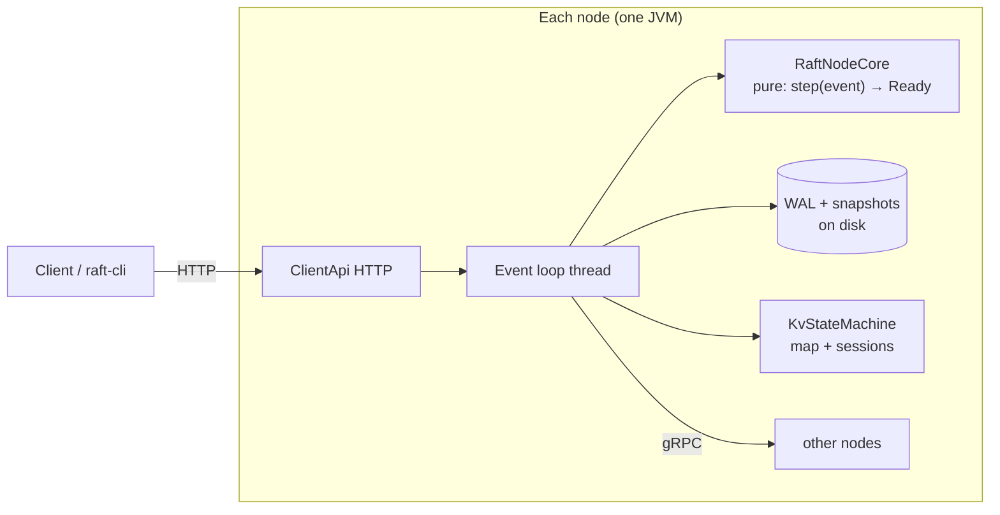

# Interview prep: Raft KV store

The questions an interviewer is most likely to ask about this project, with answers written the way you
would say them out loud. Each answer starts with a short version (say this first), then the detail if
they dig in. Numbers are measured (see the **Benchmarks** tab in the dashboard and `results/`).

**How to use it:** read the short answers until you can say them without looking. Then do the demo
(section 10) once end to end. Interviewers trust a project much more after seeing it run.

---

## Contents
1. [The pitch](#1-the-pitch)
2. [Raft basics](#2-raft-basics)
3. [Leader election](#3-leader-election)
4. [Log replication and safety](#4-log-replication-and-safety)
5. [Durability and crash recovery](#5-durability-and-crash-recovery)
6. [Clients, exactly-once and linearizable reads](#6-clients-exactly-once-and-linearizable-reads)
7. [Hardening: PreVote and CheckQuorum](#7-hardening-prevote-and-checkquorum)
8. [Testing: how do you know it is correct?](#8-testing-how-do-you-know-it-is-correct)
9. [Performance](#9-performance)
10. [The demo](#10-the-demo)
11. [Design choices and trade-offs](#11-design-choices-and-trade-offs)
12. [Bugs I found (the stories)](#12-bugs-i-found-the-stories)
13. [What I would do next / what is missing](#13-what-i-would-do-next--what-is-missing)
14. [Behavioural questions](#14-behavioural-questions)
15. [Rapid-fire one-liners](#15-rapid-fire-one-liners)

---

## 1. The pitch

### "Tell me about this project." (60 seconds)

> I built a replicated key-value store on the Raft consensus algorithm, from scratch in Java 21, with no
> consensus library. Three or five servers keep identical copies of the data; if the leader crashes,
> the others elect a new one in about 200 ms and no acknowledged write is lost.
>
> It has leader election, log replication, a write-ahead log with crash recovery, snapshots, exactly-once
> client requests and linearizable reads. It runs as real servers over gRPC, with an HTTP API, a CLI and
> Docker Compose.
>
> The part I'm proudest of is the testing. The Raft core is a pure function with no threads or clocks, so
> I could run it in a deterministic simulator that injects message loss, partitions, crashes and torn
> disk writes, and replays any failure from one seed. Checkers verify Raft's safety properties and
> linearizability on every run. I proved the checkers work by planting real bugs and confirming they
> get caught. Then I benchmarked it: group commit made writes 14× faster.

### "Why did you build it?"
To understand consensus properly, not just read about it. Raft is behind etcd, Consul and CockroachDB,
and the only way to really learn the hard cases (split votes, the Figure 8 commit rule, crashes in the
middle of a disk write) is to build it and have a tool that finds your mistakes.

### "How big is it?"
About 9,500 lines of main code and 6,900 lines of tests in 12 Gradle modules, 411 automated tests, built in 6
milestones: election, replication, durability, clients, hardening, benchmarks.

### Architecture in one picture



**Say:** "The core is pure logic: an event goes in, a list of things to do comes out (save these entries,
send these messages, apply these). One driver thread executes that list in a fixed order: save and
fsync, then send, then apply, then answer clients. The same core runs inside the simulator and inside
the real server."

---

## 2. Raft basics

### "What problem does consensus solve?"
Several machines must agree on one sequence of commands, even when some crash or messages get lost. If
they all apply the same commands in the same order, they all end up with the same data (a *replicated
state machine*). That gives you a database that keeps working when a machine dies.

### "Explain Raft in two minutes."
1. **One leader at a time.** Every node is a follower, candidate or leader. Time is divided into numbered
   **terms**, with at most one leader per term.
2. **Election.** If a follower hears nothing from a leader for a random timeout (150–300 ms here), it
   becomes a candidate, increases the term and asks for votes. A majority of votes makes it leader.
3. **Replication.** Clients send commands to the leader. It appends them to its log and sends them to
   followers in `AppendEntries`. Once a **majority** has stored an entry, it is **committed**: it will
   never be lost. Then everyone applies it to their state machine.
4. **Safety rule.** A node only votes for a candidate whose log is at least as up to date as its own, so
   the winner always has every committed entry.

### "Why a majority?"
Any two majorities overlap in at least one node. So the next leader's majority of votes always includes
someone who has every committed entry, and that voter refuses a candidate that is missing it. With 3
nodes you can lose 1; with 5 you can lose 2. In general `2f + 1` nodes survive `f` failures.

### "Why not 4 nodes?"
A majority of 4 is 3, so 4 nodes survive only 1 failure, the same as 3 nodes, but with more machines
and slower commits. Odd sizes are the sweet spot.

### "Raft vs Paxos?"
They solve the same problem with similar guarantees. Raft was designed to be understandable: one
strong leader, a log with no holes, and clear separation of election, replication and safety. Multi-Paxos
in practice ends up similar, but its papers leave many details to the implementer.

### "What does Raft NOT give you?"
Availability during a partition where no side has a majority (it chooses consistency: the CAP "C").
It doesn't scale writes by adding nodes, because every write goes through one leader. And it doesn't
handle malicious nodes (that needs Byzantine fault tolerance).

---

## 3. Leader election

### "How does an election work?"
A follower's election timer runs out, so it becomes a candidate: term + 1, votes for itself, saves that
to disk, and sends `RequestVote` to everyone. Each node grants at most **one vote per term**, saved to
disk before replying, and only if the candidate's log is at least as up to date. A majority makes it
leader; it immediately sends heartbeats so others reset their timers.

### "Why is the timeout random?"
To avoid **split votes**. If all followers timed out together, they would all become candidates and split
the votes, again and again. Random 150–300 ms means one usually times out first and wins before the
others start. I measured this: in 100 leader kills on 3 nodes, 2 had a split vote, which cost one extra
round (about 380 ms instead of 200 ms).

### "Why must the vote be saved to disk before replying?"
Otherwise a node could vote, crash, restart with no memory of it, and vote for a second candidate in the
same term. Two leaders in one term breaks everything. My simulator checks this (the vote durability
checker), and a planted "lying disk" bug (fsync that does nothing) is caught by it.

### "What does 'at least as up to date' mean exactly?"
Compare the **last entry's term** first: higher wins. If equal, the **longer log** wins. Not just "longer
log": a long log full of entries from an old term can be missing a committed entry from a newer term.

### "What is the heartbeat interval and why?"
50 ms, a third of the minimum election timeout, so a follower gets about three heartbeats before it
would suspect the leader. Too close to the timeout and a slightly late heartbeat triggers a needless
election.

### "Can there be two leaders at the same time?"
Yes, briefly, but in **different terms**. An old leader cut off by a partition may still think it is
leader in term 5 while a new one is elected in term 6. The old one cannot commit anything, because it
can't reach a majority, and the first message it gets from term 6 makes it step down. What Raft
guarantees is **at most one leader per term** (Election Safety), and my checker verifies exactly that.

---

## 4. Log replication and safety

### "What happens on a write, step by step?"

```mermaid
sequenceDiagram
    participant C as Client
    participant L as Leader
    participant F1 as Follower 1
    participant F2 as Follower 2
    C->>L: PUT x=1
    L->>L: append to log, fsync
    L->>F1: AppendEntries(entry)
    L->>F2: AppendEntries(entry)
    F1->>F1: append, fsync
    F1-->>L: ok
    Note over L: leader + F1 = majority → committed
    L->>L: apply to the map
    L-->>C: ok (previous value)
    F2-->>L: ok (later; still fine)
```

The client gets "ok" only after a majority has the entry **on disk**. That is why an acknowledged write
survives any single crash.

### "How do followers detect a mismatched log?"
Every `AppendEntries` carries the index and term of the entry just before the new ones. The follower
accepts only if it has that same entry. That gives the **Log Matching** property: if two logs share an
entry with the same index and term, everything before it is identical too. If the check fails, the
leader backs up and retries earlier.

### "Backing up one entry at a time is slow. What did you do?"
Fast backup: the follower's rejection says "I have term T at that index, and term T starts at index I",
so the leader skips the whole conflicting term in one step. I first built the simple version; the
simulator's liveness check failed because recovery after long partitions was too slow, which is what
made me add it.

### "When does a follower delete entries?"
Only when a new entry **conflicts** (same index, different term): then it deletes that entry and
everything after. It must not truncate on a mere match, because a delayed, older `AppendEntries` could
otherwise delete entries that a newer message already added. I planted exactly that bug
(`TRUNCATE_ON_MATCH`) and the checkers catch it.

### "What is the Figure 8 problem?" (a favourite)
A new leader must **not** mark an entry from an *older term* as committed just because a majority has it.
The paper's Figure 8 shows a sequence where such an entry, even after reaching a majority, is later
overwritten by another leader. Fix: a leader only counts replicas for entries **from its own current
term**. Older entries become committed indirectly, when an entry from the current term after them
commits. That's why a new leader appends a no-op entry right away.

**Say:** "I planted the 'count replicas for old-term entries' bug. It's hard to trigger: it needs a very
specific sequence of crashes and elections, so I had to make the simulator send one entry per message to
reach it. That taught me how rare some consensus bugs are, and why random testing needs to run
thousands of seeds."

### "Raft's five safety properties?"
1. **Election Safety:** at most one leader per term.
2. **Leader Append-Only:** a leader never overwrites or deletes its own entries.
3. **Log Matching:** same index and term means identical logs up to there.
4. **Leader Completeness:** a committed entry is in every later leader's log.
5. **State Machine Safety:** no two nodes apply different commands at the same index.

Each has its own checker class in my simulator, run on every event.

---

## 5. Durability and crash recovery

### "What exactly is saved to disk, and when?"
The current term, who I voted for, the log entries, and snapshots. They are saved and **fsynced before**
the node sends any message that depends on them. My driver always does: save + one fsync → send →
apply → answer. If an fsync fails, the node stops (fail-stop), because it no longer knows what is on
disk.

### "How does your write-ahead log work?"
One append-only file of typed records (term/vote, entries, truncation, snapshot markers). Each record has
a length and a CRC32C checksum. On restart I replay the records to rebuild the state. The file is split
into segments, and a new segment starts only right after a successful fsync.

### "What if the machine crashes in the middle of writing?"
The last record may be half-written (a **torn write**). On recovery, bad bytes **at the end of the last
segment** are a torn tail: never acknowledged, so it's safe to cut them off. Bad bytes **anywhere else**
mean real corruption, and the node refuses to start rather than silently losing data. The rule "segments
roll only after a sync" is what makes this distinction valid. My simulated disk models this: on a crash
it keeps synced bytes and garbles unsynced ones.

### "What is fsync and why does it matter so much?"
Writing to a file only puts data in the OS's memory cache. `fsync` forces it onto the physical disk. Without
it, a power cut can lose writes you already acknowledged. It's also the slowest step: about 3 ms here, so
it decides throughput (see group commit).

**Bonus fact you measured:** on macOS plain `fsync()` takes 0.03 ms because it only reaches the drive's
cache. The truly durable call is `F_FULLFSYNC` (about 3 ms). I measured Java's `force(true)` at the same
3 ms, so on this JDK it does the full flush, and my benchmark numbers are honest durable numbers.

### "Why snapshots?"
Without them the log grows forever and a restart replays everything. Every 10,000 applied entries the node
saves the whole map (plus client sessions) to a snapshot file and deletes the log before it. Order matters:
the snapshot file must be durable **before** the log is cut. A planted bug that skips the snapshot's fsync
(`SKIP_SNAPSHOT_DATA_FSYNC`) is caught.

### "What if a follower is so far behind that the leader already deleted the entries it needs?"
The leader sends its snapshot with `InstallSnapshot`, in chunks (Figure 13 of the paper). The follower
replaces its state with it and continues from there. A follower must not throw away a log that is
**newer** than the snapshot; that's another planted bug (`NAIVE_INSTALL_SNAPSHOT`) the checkers catch.

---

## 6. Clients, exactly-once and linearizable reads

### "A client sends PUT, the leader crashes, no reply. What should the client do?"
Retry, but a blind retry can apply the command twice. So each client has an ID and numbers its requests
(1, 2, 3...). A retry keeps the **same number**. The state machine remembers, per client, the last
number it executed and that reply. A duplicate gets the saved reply instead of running again. Retries
plus deduplication give **exactly-once** behaviour.

### "Why is PUT not idempotent? Setting x=1 twice is still x=1."
Because of other clients. Client A's `PUT x=1` is applied, the reply is lost. Client B then writes x=2 and
gets "ok". A retries `x=1`: without dedup x becomes 1 again and B's acknowledged write silently
disappears. That breaks linearizability. My planted `SKIP_DEDUP` bug is caught by the linearizability
checker in every run.

### "Where does deduplication happen?"
At **apply** time, in the state machine, not when the request arrives. A retry may become a second log
entry; when it is applied, the session table says "already done" and returns the saved reply. Because the
session table is part of the replicated state (and the snapshot), every replica deduplicates identically.

### "What is linearizability?"
Every operation appears to happen at one instant between when the client sent it and when it got the
answer, and everyone agrees on the order. In practice: once a write is acknowledged, every later read
sees it, as if there were one machine.

### "How do you serve reads? Why not just read from the leader's memory?"
A leader that was cut off may not know it has been replaced, and would return stale data. Options:
1. Put reads in the log: correct, but each read costs a log entry and an fsync.
2. **ReadIndex** (what I built): the leader notes its commit index, confirms it's still leader with one
   heartbeat round to a majority, waits until it has applied up to that index, then answers from memory.
   No disk write.
3. Leases: skip the heartbeat round by trusting clocks. Faster, but safety then depends on clock
   behaviour, so I chose not to.

Measured: an idle read takes 0.4 ms against 8 ms for a write.

### "Any subtle ReadIndex rule?"
Two:
1. A new leader must first commit an entry from **its own term** (the no-op) before serving reads. Until
   then its commit index may lag behind what the previous leader committed.
2. The heartbeat round must be counted correctly. I found a real bug here (seed 4811, section 12): a
   rejection of an **old-term** message echoed a read round that the leader then wrongly counted as
   confirmation.

### "Can followers serve reads?"
Not in my version: they redirect to the leader. Follower reads (ask the leader for the read index, wait,
answer locally) would spread read load. It's a listed extension.

### "How do you check linearizability?"
The simulator records every client operation (start time, end time, result). At the end a checker
searches for a valid order (the Wing & Gong algorithm with memoization, as in the Knossos and Porcupine
tools), separately per key, which keeps it fast. Operations whose result is unknown (the client gave up)
may or may not have happened, so the checker tries both. Three planted read and dedup bugs are caught by
it.

---

## 7. Hardening: PreVote and CheckQuorum

### "A node is partitioned away and comes back. What goes wrong in basic Raft?"
While isolated, it keeps timing out and increasing its term (say to 50). When it returns, its high term
forces the healthy leader (term 7) to step down, causing a needless election even though nothing was
wrong.

### "How does PreVote fix that?"
Before really starting an election, a node asks "would you vote for me?" **without** increasing its term.
Others say yes only if they haven't heard from a leader recently and its log is up to date. The isolated
node never gets a majority of yes answers, so its term never grows and it can't disrupt anyone.

### "And CheckQuorum?"
A leader that hasn't heard from a majority within an election timeout steps down by itself. Without it, a
leader cut off from the majority keeps thinking it is leader, and clients talking to it just time out.

### "Did these cause any testing surprises?"
Yes. They **hide** other bugs. PreVote's own log check masked a broken vote check, and CheckQuorum shrinks
the window for stale reads. So my mutation tests for older bugs run with hardening **off**, and the
masking itself is pinned as a test. Lesson: a safety feature can make a test pass for the wrong reason.

---

## 8. Testing: how do you know it is correct?

**This is the section that impresses. Lead with it whenever you can.**

### "How did you test a distributed system?"
> Three layers.
>
> 1. **Unit tests** on the pure core: give it an event, check the output.
> 2. **A deterministic simulator.** All nodes run in one thread with a fake clock, a fake network and a
>    fake disk, all driven by one random seed. It injects message loss, duplication, long delays, one-way
>    partitions, crashes (including in the middle of an fsync) and torn writes. The same seed always gives
>    exactly the same run, so any failure can be replayed and debugged step by step.
> 3. **Real processes**: three JVMs on localhost, killed with `kill -9` in a loop while clients write;
>    afterwards the history is checked for linearizability.

### "What do the checkers check?"
Seven invariants on every simulated run: Election Safety, vote durability, Log Matching, Leader
Append-Only, Leader Completeness, State Machine Safety, durability of acknowledged writes, plus
linearizability of what clients saw. Also liveness: after faults stop, a leader is elected and client
requests complete within a time window.

### "How many runs?"
Each milestone's gate: **5,000 seeds × 3 and 5 nodes × chaos and crash-loop fault mixes**, with zero
violations. A single seed simulates several seconds of cluster time in a few milliseconds of real time.

### "How do you know the checkers aren't just always passing?"
> I planted bugs. Each is a one-line, test-only switch in the real code: skip the vote's log check, fsync
> that does nothing, count old-term replicas (Figure 8), skip deduplication, serve reads without
> confirming leadership, and so on (11 in total). Each must be caught by the checkers. The dashboard has a
> **blind test**: you pick bugs and how many, it hides them among clean seeds, and reveals the answer key
> at the end. The important number is **zero false alarms**: no clean seed was ever flagged.

### "Your blind test caught only about 70%. Isn't that bad?"
No, and it's a good discussion point. A miss means that seed's random faults **never created the
situation the bug breaks**. For example, the Figure 8 bug needs a rare sequence of elections. When the
situation does occur, it's caught. Detection per seed measures how often chaos reaches that corner, not
checker quality. That's why the mutation tests run hundreds of seeds per bug, under the
fault settings that reach it, and every one of the 11 is caught.

### "Why must the core be pure (no threads, no clock)?"
Determinism. If the core read the clock or started threads, the same seed could produce different runs
and a failure might never reproduce. Pure core plus one driver means the simulator and the real server
run the **same** code, only with a different network, disk and clock underneath.

### "What's FoundationDB-style testing?"
Exactly this approach: deterministic simulation of the whole system with injected faults. FoundationDB
made it famous; TigerBeetle uses it too. Raft papers also suggest it, and Jepsen does the black-box
version on real clusters.

---

## 9. Performance

### "How fast is it?"
On one MacBook, 3 nodes, every write durably fsynced on a majority:
- **about 2,075 writes/s** with 64 clients, **p99 50 ms**;
- **about 150 writes/s** with group commit off;
- reads: 0.4 ms when idle (ReadIndex, no disk);
- leader failover: **p50 199 ms, p99 386 ms** over 100 `kill -9`s.

### "What is group commit and why does it help so much?"
The disk flush (about 3 ms) is the bottleneck. Without batching each write pays its own flush, one after
another, so throughput stays near 150/s no matter how many clients there are. With group commit, the
server takes **everything waiting in its queue**, writes it all, and does **one** fsync for the batch.
At 64 clients one flush carries about 45 writes, so 148 → 2,075 writes/s (**14×**) and p99 drops from
541 ms to 50 ms.

### "Doesn't batching add latency?"
Not here, because there's no timer: the server never waits for a batch to fill. It flushes whatever has
arrived. A single client gets the same latency as before; only waiting requests share the flush.

### "Is the order still safe with batching?"
Yes. The rule is unchanged: nothing is sent or acknowledged until the batch's fsync completes. I planted a
bug that sends before the fsync (`SEND_BEFORE_SYNC`) and the checkers catch it when a crash hits between
send and fsync.

### "How do you know your latency numbers make sense?"
Little's law: clients = throughput × latency. 64 clients ÷ 148 writes/s ≈ 432 ms; measured median 442 ms.
With batching: 64 ÷ 2,075 ≈ 31 ms; measured 31 ms. The numbers are self-consistent.

### "3 nodes vs 5 nodes?"
5 nodes is slower (1,234 vs 2,075 writes/s): the leader sends to 4 followers and waits for 3 flushes instead
of 2, and here all 5 share one laptop's CPU and SSD. More nodes buy fault tolerance, not speed.

### "How would you make it faster?"
1. **Pipelining:** let the leader send new entries before earlier ones are acknowledged.
2. **Follower reads**, to take read load off the leader.
3. **Leases** for reads, if bounded clock drift is acceptable.
4. **Parallel fsync:** the leader fsyncs while followers do too. Raft allows the leader to write to its
   own disk in parallel with sending.
5. **Sharding (Multi-Raft):** many Raft groups, each owning a key range, as in CockroachDB and TiKV. That's
   how you scale writes.

### "Tell me about a performance bug you found."
The Nagle story in section 12.

---

## 10. The demo

Have these ready before the call (Docker Desktop running):

```
./gradlew :raft-dashboard:run          # dashboard at http://localhost:8090
docker compose up -d --build           # 3-node cluster on :8081-8083
```

**Five minutes, in this order:**
1. **Simulator tab:** run 500 seeds with no bug → all green. *"Each seed is a different random disaster:
   lost messages, partitions, crashes in the middle of a disk write."*
2. Choose bug `SKIP_DEDUP`, run 100 → all red. Click a seed to show which checker caught it and why.
3. **Blind bug test:** plant a few bugs, run, show the answer key and **0 false alarms**.
4. **Throughput tab:** 64 clients, group commit on, live chart. Then the **Benchmarks** tab for the
   explained results (group commit 14×, failover, the Nagle bug).
5. **Terminal**, with the real cluster:
   ```
   raft-server/build/install/raft-server/bin/raft-cli --cluster 1=http://localhost:8081,2=http://localhost:8082,3=http://localhost:8083 put demo hello
   ... get demo
   ... status                             # shows who is leader
   docker compose kill node<leader>       # kill -9 the leader
   ... get demo                           # still "hello", from the new leader
   docker compose start node<leader>      # it rejoins as a follower and catches up
   ```

**If something goes wrong in the demo:** stay calm, and say what you would check (`status`, the node
logs). Debugging calmly is a good signal too.

---

## 11. Design choices and trade-offs

| Question | My choice | Why | Alternative |
|---|---|---|---|
| Core style | Pure `step(event) → Ready` | Deterministic simulation, same code in sim and server | Threads + locks inside the core (untestable) |
| Threading | One event-loop thread per node | No locks in protocol code, easy to reason about | Thread pool + locks |
| Storage | Own WAL with CRC + torn-tail cut | Learn durability properly, full control of fsync | RocksDB / an embedded DB |
| Network | gRPC client-streaming per peer, bounded queue, drop when full | Raft tolerates loss, so dropping beats blocking | One RPC per message |
| Message format | Protobuf on the wire, own binary codec for the log | Canonical, compact, versioned | Java serialization (fragile) |
| Reads | ReadIndex | Linearizable without a log write, no clock assumptions | Leases (clock-dependent), log reads (slow) |
| Dedup | Session table in the state machine, at apply time | Replicated and snapshotted, so identical on all replicas | Dedup at the leader only (lost on failover) |
| Client API | HTTP/JSON for people, binary for the Java client | Easy curl demos, efficient programs | gRPC for clients too |
| Language | Plain Java 21, no framework | Nothing hidden; records, sealed types, virtual threads | Spring (too much magic for a consensus core) |

### "Why not Spring?"
A consensus core needs exact control over threads, ordering and I/O. Spring's value (DI, web stack) doesn't
help with that, and its magic hides what happens. I used plain JDK classes plus gRPC and Micrometer.

### "Why sealed classes for roles?"
`Follower`, `Candidate` and `Leader` each hold only the state that role needs (only a leader has
`nextIndex`/`matchIndex`). With a sealed interface and `switch`, the compiler checks every role is handled,
and illegal states like "a follower with matchIndex" can't be represented.

### "What does fail-stop mean in your design?"
If an fsync fails, the node halts instead of continuing. It no longer knows what's durable, and
continuing could violate its promises (for example, forgetting a vote). Crashing is safe in Raft; lying
is not. (Postgres learned this the hard way with its 2018 "fsyncgate".)

---

## 12. Bugs I found (the stories)

Interviewers love "tell me about a hard bug". Use the **situation → how I found it → cause → fix →
lesson** shape.

### Story 1: the stale ReadIndex confirmation (seed 4811)
- **Found by:** the linearizability checker flagged a stale read in one seed of the 5,000-seed gate.
- **Replay:** I replayed seed 4811 with a longer trace. A follower that had already moved to a **newer
  term** rejected an **old** AppendEntries and echoed that message's read-round number in the rejection.
  The leader counted the echo as "this follower confirms I'm still leader", so a read was served without a
  real majority confirmation.
- **Fix:** a rejection of an older term's message echoes round 0, so it can never count as a
  confirmation. Pinned as a regression test.
- **Lesson:** a message proves something only for the term it belongs to. Determinism made a once-in-5,000
  bug reproducible on the first try.

### Story 2: the 40 ms Nagle stall (found while benchmarking)
- **Symptom:** on Docker (Linux) one client got 20 writes/s at 51 ms each. On the Mac it was fine.
- **Narrowing:** `curl` was fast (5 ms) but Java's client slow (50 ms), even for a request with no body.
  The difference: curl opened a new connection each time; Java reused one. With curl reusing a
  connection, the first request took 3 ms and **every later one 42 ms**.
- **Cause:** the JDK HTTP server writes the response headers and body separately. Nagle's algorithm holds
  the second piece until the first is acknowledged, and Linux delays acknowledgements by up to 40 ms.
- **Fix:** `TCP_NODELAY` on the server (`sun.net.httpserver.nodelay=true`): 20 → 543 writes/s, 64 clients
  1,396 → 4,655. A test pins the setting.
- **Lesson:** measure each layer separately, and benchmark on the OS you deploy to.

### Story 3: a checker that was wrong, not the code (seed 327)
My checker assumed "a committed entry is never deleted from any node's log". Seed 327 failed it, but the
Raft code was right: a node that is still behind (its term is older than the term the entry was committed
in) may legally hold a *different*, stale entry at that index and later replace it. That is the Figure 8
situation. The invariant only holds for nodes at or past the commit term, so I fixed the checker.
**Lesson:** test oracles have bugs too; when a check fails, verify the property before "fixing" the code.

### Story 4: the liveness window (seed 3064)
The M5 gate failed once on a liveness check, not a safety one: one client had done nothing for 1,089 ms at
the end of the run, over the 1 s limit. The cause was bad luck, not a bug: client links still drop 5% of
messages in the quiet period, and that client lost five round trips in a row to a perfectly stable leader.
I measured the real distribution over 4 × 5,000 seeds (p99.9 ≈ 790 ms, max 1,089 ms) and set the client
window to 2 s, keeping 1 s for the cluster checks. The seed is pinned as a regression test.
**Lesson:** liveness checks need measured bounds, not guesses, and a red test is not always a code bug.

---

## 13. What I would do next / what is missing

Be upfront: knowing your system's limits is a senior signal.

| Missing | Why it matters | How I would add it |
|---|---|---|
| Membership changes (add/remove nodes) | Can't replace a dead machine without downtime | Joint consensus, or single-server changes (thesis ch. 4) |
| Session expiry | The session table grows with every client ever seen | Expire using the leader's timestamp stored in log entries, so every replica expires the same way |
| Follower reads | The leader serves every read | ReadIndex from the leader, then wait locally and answer |
| Pipelining | One request in flight per client limits a client's throughput | Windows of sequence numbers in sessions |
| Sharding / Multi-Raft | One leader limits total write throughput | Many Raft groups, each owning a key range |
| Real multi-machine benchmark | Laptop numbers share one CPU and SSD, with no network delay | Run on 3 cloud VMs in different zones |
| Lease reads | Saves a round trip per read | Only with bounded clock drift; I chose safety over speed |

### "What would break first in production?"
Memory from the unbounded session table with many short-lived clients, and lack of membership change
when a disk dies. And performance on a real network, where each write adds a round trip.

---

## 14. Behavioural questions

### "What was the hardest part?"
Getting the ordering right around the disk: when to fsync relative to sending and answering, and making
crash recovery distinguish a torn last write from real corruption. And learning to distrust a passing test.
The planted-bug approach came from asking "would my tests even notice if this were wrong?"

### "What did you learn?"
1. Consensus bugs live in rare interleavings, so you need thousands of randomized, reproducible runs.
2. Separate pure logic from I/O; it makes everything testable.
3. Measure, don't guess: my latency intuition was wrong several times, and Little's law caught it.
4. The disk is usually the bottleneck in a durable system, and batching is the main fix.

### "If you started again, what would you change?"
I would build the deterministic simulator and the checkers even earlier, on day one, and I would add
membership changes to the plan from the start, since they touch the core's assumptions about who the
peers are.

### "How did you work on it?"
In milestones with exit gates: each one had to pass 5,000 seeds and catch its planted bugs before I moved
on. I wrote the tests first and documented every decision and every shortcut (DESIGN.md, DEVIATIONS.md).

---

## 15. Rapid-fire one-liners

| Question | Answer |
|---|---|
| Term? | A logical clock: increases on each election, at most one leader per term. |
| Committed? | Stored on a majority, by a leader of the current term; can never be lost. |
| Applied? | Executed on the state machine (committed first, then applied in order). |
| commitIndex vs lastApplied? | Highest index known committed vs highest index executed. |
| nextIndex / matchIndex? | Leader's guess of the next entry to send a follower / highest index known stored there. |
| Why persist votedFor? | So a restarted node can't vote twice in one term. |
| What if a candidate gets a higher term reply? | It steps down to follower and adopts that term. |
| Does a leader ever delete entries? | Never its own (Leader Append-Only). Followers may delete conflicting, uncommitted ones. |
| Can an acknowledged write be lost? | No: it's on a majority's disk, and the next leader must have it. |
| Can a committed entry be uncommitted? | No. That's the whole point of Leader Completeness. |
| What does the no-op entry do? | Lets a new leader commit older-term entries and start serving reads. |
| Network partition, 2 vs 1? | The side with 2 elects/keeps a leader and continues; the 1 side can't commit. |
| Network partition, 5 nodes, 2 vs 3? | The 3 side continues; the 2 side refuses writes. |
| Clock skew effect on safety? | None. Timers only affect when elections start, never correctness. |
| Snapshot vs log? | Snapshot = whole state at an index; replaces the log up to that index. |
| CAP? | CP: during a partition the minority side becomes unavailable rather than inconsistent. |
| Who uses Raft? | etcd (Kubernetes), Consul, CockroachDB, TiKV, Kafka KRaft, MongoDB's replication protocol (Raft-like). |
| Election timeout here? | 150–300 ms random; heartbeat 50 ms. |
| Snapshot frequency here? | Every 10,000 applied entries. |
| Test count? | 411 automated tests; gates of 5,000 seeds × 4 configurations. |
| Headline numbers? | 14× from group commit (148 → 2,075 writes/s), p99 50 ms, failover p50 199 ms. |
