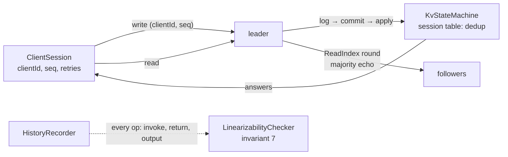
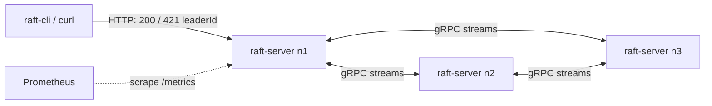

# Milestones

## M1: Leader election ✅ done (2026-11-22)

**Exit criterion:** invariant 1 (Election Safety) holds over 5,000 seeds, with partitions and crashes.

**Result:** 5,000 seeds × {3, 5} nodes with 0 violations. Each cluster size saw about 56k partitions
(some one-way), 28k crash/restarts and 27k pauses. Liveness held after healing in every run.
Mutation check (disks that lie about fsync): the vote-durability checker caught it in 50 of 50 seeds,
on average 2.6 s into the run. With that checker off, the bug produced two leaders in one term in 70 of
500 seeds, and the Election Safety checker caught every one.

Replay: `./gradlew :raft-sim:test -Psim.seeds=5000` (gate), `-Psim.seed=N` (one seed).

---

## M2: Log replication ✅ done (gate passed 2026-11-22, accepted by the owner 2026-11-23)

**Exit criterion:** invariants 1–5 hold under drops, duplicates, reordering, partitions and crashes.

**Result:** 5,000 seeds × {3, 5} nodes with 0 violations of Election Safety, Leader Append-Only, Log
Matching, Leader Completeness and State Machine Safety, plus vote durability, replica KV-state agreement
and liveness (a leader exists, commands still commit, and every node catches up). Per cluster size:
about 28k crash/restarts, 56k partitions, 26–27k pauses, 3.24M client proposals, 2.0M (3 nodes) / 2.4M
(5 nodes) committed, ~127k proposals lost to overwriting, logs up to ~630 entries. Gate runtime ~90 s.

Mutation checks (each must be caught; measured rates):

| Mutation | Seeds | Caught by |
|---|---|---|
| Skip the log up-to-date check when voting (§5.4.1) | 100 | Leader Completeness 97 |
| Commit an old-term entry by counting (Figure 8), batch size 1 | 1000 | Leader Completeness 11 (Liveness 18, unrelated: slow 1-entry catch-up) |
| Same, batch size 64 | 200 | 0: the no-op travels with the old entries, so the bad window never opens |
| Truncate even when entries match (§5.3) | 100 | Leader Completeness 49, replica state divergence 47, state machine order guard 4 |
| Lying disks (M1), vote checker on | 50 | Vote durability 50 |
| Lying disks, vote checker off | 300 | Leader Completeness 148, Election Safety 26, Log Matching 10, State Machine Safety 4 |
| Control: no mutation, batch size 1 | 100 | no safety violations (1 slow-catch-up liveness miss) |

The basic version (decrement nextIndex by one) was safe on its own (0 failures over 500 seeds × {3, 5}
with a 20 s quiet period), but too slow to catch up within the normal 3 s window; fast backup fixed that.

Re-run on 2026-11-23 before committing: build green, gate identical (same counts, so runs stay
deterministic).

Replay: `./gradlew :raft-sim:test -Psim.seeds=5000` (gate), `-Psim.seed=N` (one seed).

### Entry checklist (all done)

#### Remove the M1 shortcuts (DEVIATIONS.md)
- [x] **P1:** heartbeats/AppendEntries use real `nextIndex[p]`: `prevLogIndex = nextIndex - 1`, `prevLogTerm = termAt(prevLogIndex)`, and send entries (Figure 2).
- [x] **P2:** a new leader appends a no-op entry in its own term on election (§8). Without it, the leader can't commit entries from earlier terms (Figure 8).
- [x] **P3:** `ProposeCommand` is handled by appending to the leader's log and emitting `ProposalAccepted`, or `ProposalRejected` with a leader hint on a non-leader. Non-empty AppendEntries are processed, not thrown. (`ReadRequested` stays loud until M4 and moves to the M4 checklist.)
- [x] `NodeDriver` applies `Ready.toApply` to the `KvStateMachine` (step 3 of E1) instead of throwing.
- [x] `grep -rnE "M1 only|arrives? in M2" raft-*/src/main` returns nothing, and P1 and P2 are deleted from DEVIATIONS.md (P3 shrinks to the M4 part). Done: the grep returns nothing.

#### New invariant checkers (separate classes, separate failure messages)
- [x] **Log Matching (invariant 3, §5.3):** if two logs have the same (index, term), their prefixes up to that index are identical.
- [x] **Leader Completeness (invariant 4, §5.4):** every committed entry is in the log of every leader of a later term. In M1 this was untestable because logs were empty.
- [x] **State Machine Safety (invariant 5, §5.4.3):** no two nodes apply different entries at the same index.
- [x] **Leader Append-Only (invariant 2):** a leader never overwrites or deletes entries in its own log.
- [x] Election Safety stays its own checker. Leader Completeness is a different property, so it gets its own checker and its own failure message rather than being folded into Election Safety.

#### Log up-to-date check under real load
- [x] The election restriction (§5.4.1) is exercised by chaos runs with non-empty, diverging logs. In M1 it was covered only by unit tests.
- [x] **Mutation:** skipping the log up-to-date check in `onRequestVote` is caught by Leader Completeness / State Machine Safety in some seed.
- [x] **Mutation:** committing an entry from an older term by counting replicas (the Figure 8 bug) is caught.

#### Unit scenarios from the paper
- [x] The Figure 7 follower logs (a)–(f) all converge to the leader's log.
- [x] The Figure 8 sequence: an old-term entry on a majority is not committed until a current-term entry is.
- [x] Reordered or duplicated AppendEntries never truncate entries that already match.
- [x] Reordered AppendEntriesResponses never move `matchIndex` backwards.

#### Then
- [x] Fast log backup (conflictTerm / conflictIndex), added only after the basic version passes.
- [x] Gate: invariants 1–5 hold over 5,000 seeds with drops, duplicates, reordering, partitions and crashes.

### Carried to M4
- [x] `ReadRequested` / ReadIndex (P3 remainder). Client retries, sessions and dedup; lossy client links (H1). Done in M4.

---

## M3: Durability ✅ done (gate passed and accepted by the owner 2026-11-24)

**Exit criterion:** invariant 6 (Durability) holds under random crash loops, including crashes in the
middle of a write; invariants 1–5 keep holding.

**Built:** a segmented WAL with CRC32C records, torn-tail cut and checkpoints (`FileWalStorage`) on a
`Disk` abstraction (`RealDisk`, and `SimDisk` with a page-cache crash model); atomic snapshot files
(`SnapshotStore`); a log base in the core (D1a rules 1–5); driver-triggered snapshots
(`SnapshotCreated`); chunked InstallSnapshot (Figure 13); recovery from snapshot + WAL. Every simulated
node now runs the real WAL on a `SimDisk`, and every restart runs real recovery.

**Result:** 5,000 seeds × {3, 5} nodes × {chaos, crash loop} with 0 violations of invariants 1–6, vote
durability, replica-state agreement and liveness. Runtime 2 min 31 s.

| Config | Crashes | mid-fsync | Torn tails cut | Restarts checked | Snapshots | Installs | Max log in memory |
|---|---|---|---|---|---|---|---|
| chaos, 3 | 44,904 | 22,326 | 8,619 | 59,904 | 71,782 | 14,167 | 189 |
| chaos, 5 | 46,656 | 23,194 | 8,966 | 71,656 | 153,018 | 35,673 | 190 |
| crash loop, 3 | 301,100 | 140,956 | 53,392 | 316,100 | 43,782 | 5,631 | 120 |
| crash loop, 5 | 324,898 | 159,198 | 61,240 | 349,898 | 115,943 | 25,879 | 137 |

The first gate run failed on one seed (crash loop, 5 nodes, seed 327). It was a false positive in the
new committed-entry check: it also flagged a node still in an older term, which Raft allows to lose an
entry committed later without it (Figure 8). The check now applies only to nodes at or past the commit
term (EXPLANATION.md M3 §11).

Mutation checks (measured rates):

| Mutation | Config, seeds | Caught by |
|---|---|---|
| Lying fsync (on the real WAL) | chaos, 50 | Durability 50 |
| Same, durability checkers off | chaos, 300 | Leader Completeness 212, Election Safety 43, Log Matching 18, State Machine Safety 2 (passed 20, liveness 5) |
| Recovery keeps the torn tail | crash loop, 100 | Durability 100 |
| Snapshot renamed before its data is fsynced | crash loop, 100 | Durability 59 (needs a crash that loses some of the unsynced bytes) |
| Follower installs stale snapshots / always discards its log | chaos, 100 | Durability (c) 98, RaftLog guard 1 |
| M2 truncate on match (re-measured) | chaos, 100 | Durability (c) 100 |
| Controls (batch 1; crash loop) | 100 + 100 | no safety violations |

`./gradlew build`: 250 tests, ~20 s.

### Checklist
- [x] `Disk`, `RealDisk`, `SimDisk` (crash model tested on its own)
- [x] WAL: records + CRC32C, segments, torn-tail cut, fail-stop on older-segment corruption, every-offset property test
- [x] Simulator on the real WAL; crash-during-fsync faults; crash-loop config; `DurabilityChecker` (a), (b), (c)
- [x] Snapshots: canonical KV snapshot, atomic `SnapshotStore`, log base, `SnapshotCreated` / `CompactLog`, checkpoints, recovery merge
- [x] InstallSnapshot: chunks, offsets, retransmit on heartbeat, stale-install guard, keep vs discard
- [x] Mutations M3-F caught, with control runs
- [x] Gate over 5,000 seeds
- [x] Docs: DESIGN, DEVIATIONS, CLAUDE.md, EXPLANATION.md `# M3`

---

## M4: Clients and reads ✅ done (gate passed and accepted by the owner 2026-11-25)

**Exit criterion:** invariant 7 (Linearizability) holds for the recorded client history over 1,000+
chaos runs, and the M4 mutations are caught. Invariants 1–6 keep holding.

**Built:** client sessions with exactly-once writes (dedup at apply time, in snapshots and the state
hash); `ClientSession` (one operation in flight, same seq on every retry, leader hints, timeouts);
ReadIndex reads (current-term commit, a `readRound` echoed on replication messages, wait for apply);
lossy client links; `HistoryRecorder` + `LinearizabilityChecker` (Wing & Gong with Lowe's memo, per
key); three mutations with leader-targeted faults.

**Result:** 5,000 seeds × {3, 5} nodes × {chaos, crash loop} with 0 violations of invariants 1–7, vote
durability, replica-state agreement, commit liveness and client liveness. Runtime 3 min 46 s.

| Config | Client ops | Reads | Attempts | Dedup hits | Unknown at end | Max checker steps |
|---|---|---|---|---|---|---|
| chaos, 3 | 2,778,793 | 828,283 | 5,201,465 | 656,519 | 5,097 | 1,116 |
| chaos, 5 | 3,576,365 | 1,067,595 | 5,799,628 | 1,181,729 | 8,355 | 1,248 |
| crash loop, 3 | 1,643,026 | 487,377 | 4,580,184 | 586,035 | 6 | 651 |
| crash loop, 5 | 2,565,638 | 764,252 | 5,226,128 | 1,424,296 | 176 | 1,017 |

The first gate run failed on one seed (chaos, 5 nodes, seed 4811): a **real ReadIndex bug**. A
follower rejected a long-delayed AppendEntries from the leader's older term but echoed its read round
under its own newer term; the leader counted it and, cut off from the majority, served a stale read.
Fix: a rejection of an older term's request echoes no round. Regression tests: two in `ReadIndexTest`,
plus `RegressionSeedsTest.seed4811StaleTermReadRoundEcho` (EXPLANATION.md M4 §15).

Mutation checks (measured rates):

| Mutation | Config, seeds | Caught by |
|---|---|---|
| SKIP_DEDUP (duplicates re-executed) | chaos, 100 | Linearizability 100 |
| READ_WITHOUT_QUORUM_CHECK | leader faults, 80% reads, 2 keys, 100 | Linearizability 75 |
| READ_BEFORE_CURRENT_TERM_COMMIT | leader faults, 50% reads, 1 key, 200 | Linearizability 39 |
| M2/M3 mutations, re-measured | as in M2/M3 | all still caught (Figure 8 4/1000, lying disk 50/50, snapshot fsync 67/100) |
| Controls (batch 1; crash loop; both leader-fault mixes) | 100 + 100 + 100 + 200 | no violations |

**Skipped on purpose** (owner's scope choice, 2026-11-24; none affects safety; full reasons and
interview answers in EXPLANATION.md M4 §2–§3, list in DEVIATIONS.md K1–K5):

| # | Skipped | Why it is safe to skip | Cost |
|---|---|---|---|
| K1 | Session expiry | 5 clients → 5 rows; correct expiry needs leader timestamps in the log so replicas expire identically | memory grows with clients ever seen |
| K2 | RegisterClient | random 64-bit ids are unique in practice; registration matters mainly together with expiry | ids unique by chance, not by construction |
| K3 | Lease reads | refused: they make safety depend on clock drift and pauses; ReadIndex is timing-free | one round trip per read batch |
| K4 | Follower reads | scaling only; followers redirect to the leader, equally correct | the leader serves all reads |
| K5 | Pipelining | one op in flight keeps dedup to "last seq + reply" | per-client throughput |

`./gradlew build`: 312 tests, green.

### Checklist
- [x] Linearizability checker first, with hand-made histories and a jqwik property
- [x] Sessions: dedup, `Stale`, snapshot v2, sessions in the state hash, `query`
- [x] `ClientSession`: same seq on retry, hints, back-off, timeouts
- [x] Simulator: closed-loop clients, lossy client links, history, invariant 7, client liveness
- [x] ReadIndex in the core and the driver; reads no longer go through the log
- [x] Mutations M4-F caught, with controls
- [x] Gate over 5,000 seeds (bug at seed 4811 found and fixed, regression pinned)
- [x] Docs: DESIGN, DEVIATIONS, CLAUDE.md, README, EXPLANATION.md `# M4`
- [x] Accepted by the owner 2026-11-25; committed and pushed

## M5: Hardening ✅ done (accepted by the owner 2026-11-25)

**Exit criterion (brief):** PreVote, CheckQuorum, gRPC transport, metrics (term, role, commitIndex,
lastApplied, election count, replication lag, fsync latency), a CLI client, and kill -9 integration
tests on real processes. Invariants 1–7 keep holding.

**Built:** PreVote + CheckQuorum + leader stickiness in the core behind flags (on in the simulator and the
server); `raft-proto` + gRPC `GrpcTransport`/`GrpcPeerServer` (one stream per peer, bounded queue, drop
when full); `raft-server` (one event-loop thread over a mailbox, file WAL on the real disk, fail-stop);
HTTP client API (JSON + binary), `HttpClusterClient` and `raft-cli` on `ClientSession`; Micrometer +
Prometheus at `/metrics`; `KillNineIntegrationTest`; `raft-server/Dockerfile` + working `compose.yaml`.

**PreVote / CheckQuorum, measured** (`HardeningScenarioTest`, 100 seeds per row, one node cut off for 3 s):

| Scenario | PreVote | CheckQuorum | Result |
|---|---|---|---|
| isolate a follower (3 and 5 nodes) | on | on | 0/100 disrupted, term growth 0 |
| isolate a follower (5 nodes) | off | on | 100/100 disrupted, term +26 |
| isolate the leader (3 and 5 nodes) | on | on | steps down after 98–204 ms |
| isolate the leader (3 nodes) | on | off | keeps the role 3,001–3,013 ms (until the heal) |
| isolate the leader (3 nodes) | off | on | steps down in 98–204 ms, term +24 |
| mutation `PREVOTE_BUMPS_TERM` | | | caught: 100/100 disrupted, term +25 |

**Gate** (5,000 seeds × {3, 5} × {chaos, crash loop}, hardening on): 0 violations of invariants 1–7, vote
durability, replica state, commit and client liveness. Runtime 3 min 39 s. Max term in chaos: 18 / 20
(M4: up to 62). The first run failed on seed 3064 (chaos, 5 nodes): client liveness, not safety. A
stable leader and five lost round trips on a 5%-lossy client link. The idle-time distribution, measured
over 20,000 runs, maxed at 1,089 ms with the features on or off, so the client window became 2 s
(DEVIATIONS.md H6). The seed is pinned in `RegressionSeedsTest`.

| Config | Elections | Max term | Crashes | Client ops | Dedup hits |
|---|---|---|---|---|---|
| chaos, 3 | 32,792 | 18 | 41,813 | 2,717,114 | 559,220 |
| chaos, 5 | 32,118 | 20 | 45,214 | 3,617,108 | 1,062,344 |
| crash loop, 3 | 42,240 | 25 | 255,991 | 1,585,290 | 522,169 |
| crash loop, 5 | 61,617 | 32 | 300,777 | 2,449,733 | 1,308,437 |

**Mutations** (all M2–M4 ones still caught; the ones PreVote/CheckQuorum would mask run with them off):

| Mutation | Config, seeds | Caught by |
|---|---|---|
| SKIP_UP_TO_DATE_CHECK, hardening off | chaos, 100 | Leader Completeness 89 |
| same, PreVote on (masking control) | chaos, 100 | 0: PreVote's log check hides it |
| SKIP_UP_TO_DATE_CHECK + PREVOTE_SKIPS_LOG_CHECK | chaos, 100 | Leader Completeness 56 |
| PREVOTE_SKIPS_LOG_CHECK alone | chaos, 300 | 0, expected: safety still holds (PreVote is liveness only) |
| READ_WITHOUT_QUORUM_CHECK, CheckQuorum off / on | leader faults, 100 | Linearizability 76 / 11 |
| READ_BEFORE_CURRENT_TERM_COMMIT | leader faults, 200 | Linearizability 34 |
| SKIP_DEDUP | chaos, 100 | Linearizability 100 |
| Figure 8 (batch 1, hardening off), lying disk, torn-tail, truncate on match, snapshot fsync, naive install | as before | 4/1000, 50/50, 98/100, 100/100, 58/100, 98/100 |
| Controls (batch 1, crash loop, both leader-fault mixes) | 100 + 100 + 100 + 200 | no violations |

**Real processes** (`./gradlew :raft-server:integrationTest`): 6 runs, 162 SIGKILLs (116 of the leader),
109,288 client operations, every history linearizable, every node caught up, no operation lost to a
timeout. Docker: `docker compose up -d --build`, a 421 redirect, a SIGKILL of the leader and a restart,
checked by hand (EXPLANATION.md M5 §9.3).

`./gradlew build`: 369 tests, green.

### Checklist
- [x] PreVote, CheckQuorum, stickiness: unit tests first, then core, behind flags
- [x] Measured on/off in the simulator; masking findings pinned as tests
- [x] `raft.proto`, `ProtoMapping` (round-trip property), `GrpcTransport` + `GrpcPeerServer`
- [x] `raft-server`: config from env, event loop, fail-stop, client API, metrics
- [x] `HttpClusterClient`, `raft-cli`
- [x] Gate over 5,000 seeds (seed 3064 investigated: harness window, H6)
- [x] kill -9 integration test, Dockerfile, compose verified
- [x] Docs: DESIGN M5, DEVIATIONS (H3, H6, R1–R4), README, CLAUDE.md, EXPLANATION.md `# M5`
- [x] Accepted by the owner

## M6: Benchmarks ✅ done (2026-11-27)

**Exit criterion (brief):** benchmarks of throughput, latency and failover on real processes, reported with
method and limits.

**Built:** group commit (DESIGN.md M6-A) in `NodeDriver.handleBatch`, the server's mailbox drain and the
simulator (`withBatching`), with the `SEND_BEFORE_SYNC` mutation; `raft-bench` (`load`, `failover`, `matrix`,
`load --attach`); `raft-dashboard` (`MainApplication`, :8090: Simulator, Blind bug test, Throughput &
latency, Leader failover, Compare runs, Benchmarks); the TCP_NODELAY fix (M6-D); BENCHMARKS.md;
INTERVIEW_PREP.md.

**Results** (full tables: [BENCHMARKS.md](BENCHMARKS.md)):

| Measurement | Result |
|---|---|
| Group commit, 3 nodes, 64 clients, writes only | 148 → 2,075 writes/s, p99 541 → 50 ms, 45 writes per fsync |
| Same, 5 nodes | 119 → 1,234 writes/s |
| Idle read / write p50 | 0.4 / 8.0 ms |
| Failover, 100 kills: 3 nodes / 5 nodes | election p50 199 / 186 ms, p99 386 / 247 ms |
| Docker, 64 clients, after the fix | 4,655 writes/s (before: 1,396; 1 client 20 → 543) |
| macOS fsync probe | `force(true)` 2.96 ms = `F_FULLFSYNC` 2.97 ms (plain fsync 0.03 ms): S1 corrected |
| Matrix | 96 runs, 0 timeouts, spread mostly ≤ 15%, worst 39% |

**Mutations:**

| Mutation | Config, seeds | Caught by |
|---|---|---|
| SEND_BEFORE_SYNC | crash loop + batching, 3 nodes, 100 | 78 (Durability 74, Election Safety 4) |
| SEND_BEFORE_SYNC, durability checkers off | same, 300 | 97 (Leader Completeness 75, Election Safety 22) |
| Control (crash loop + batching) | 100 | no violations |

**Gate:**

5,000 seeds × {3, 5} nodes × {chaos, crash loop} × group commit {off, on} = **40,000 runs, 0 violations** of
invariants 1–7, vote durability, replica state, commit and client liveness (re-run 2026-11-27, 7 min 40 s;
hardening on).

| Config | Elections | Max term | Crashes (mid-write) | Client ops | Avg / max batch |
|---|---|---|---|---|---|
| chaos, 3 | 32,792 | 18 | 41,813 (18,739) | 2,717,114 | – |
| chaos, 5 | 32,118 | 20 | 45,214 (21,717) | 3,617,108 | – |
| chaos + group commit, 3 | 32,600 | 16 | 41,810 (18,754) | 2,483,407 | 1.56 / 163 |
| chaos + group commit, 5 | 32,120 | 20 | 45,131 (21,649) | 3,336,814 | 1.71 / 170 |
| crash loop, 3 | 42,240 | 25 | 255,991 (93,011) | 1,585,290 | – |
| crash loop, 5 | 61,617 | 32 | 300,777 (135,155) | 2,449,733 | – |
| crash loop + group commit, 3 | 39,894 | 25 | 255,130 (91,920) | 1,426,608 | 1.45 / 165 |
| crash loop + group commit, 5 | 59,840 | 33 | 301,089 (134,870) | 2,212,253 | 1.59 / 161 |

`./gradlew build`: 411 tests, green. `./gradlew :raft-server:integrationTest`: 12 kills (9 of the leader),
9,034 operations, linearizable (2026-11-27).

### Checklist
- [x] Group commit: unit tests first (`NodeDriverBatchTest`), driver, server, simulator
- [x] `SEND_BEFORE_SYNC` mutation caught; control clean
- [x] Gate over 5,000 seeds × 8 configurations (with and without batching)
- [x] `raft-bench` + tests; `raft-dashboard` + tests; blind bug test
- [x] Matrix (3 repeats), failover (100 kills × {3, 5}), Docker run, macOS fsync probe
- [x] Docker benchmark finding fixed (TCP_NODELAY), pinned by a test
- [x] Docs: BENCHMARKS.md, DESIGN M6, DEVIATIONS (S1 corrected, BM1–BM5), README, CLAUDE.md,
      EXPLANATION.md `# M6`, INTERVIEW_PREP.md
