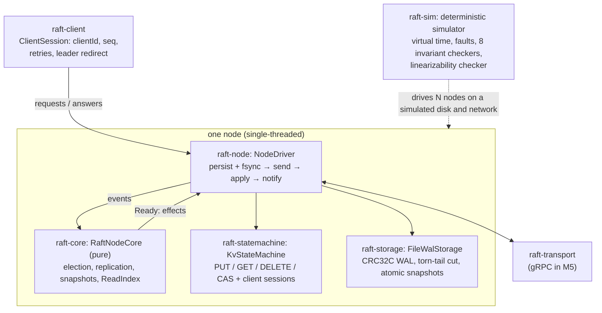

# Distributed-Raft-based-KV-store

A replicated key-value store built on Raft, written from scratch in plain Java 21 with no Raft library
and no framework. The protocol core is a pure, deterministic state machine. A deterministic simulator
runs thousands of seeded chaos runs against it (dropped, duplicated and reordered messages, partitions,
crashes in the middle of an fsync, process pauses) and checks every Raft safety property after every
event, plus linearizability of what clients saw.

## Architecture



## Status

| Milestone | What | State |
|---|---|---|
| M1 | Leader election | done |
| M2 | Log replication, KV state machine, fast log backup | done |
| M3 | Write-ahead log, crash recovery, snapshots, InstallSnapshot | done |
| M4 | Client sessions (exactly-once writes), ReadIndex reads, linearizability checker | done |
| M5 | PreVote, CheckQuorum, gRPC, metrics, CLI | next |
| M6 | Benchmarks and report | later |

Each milestone ends with a gate of 5,000 seeds × {3, 5} nodes × {chaos, crash loop} with zero
violations, plus deliberately injected bugs ("mutations") that the checkers must catch. Numbers are in
[MILESTONES.md](MILESTONES.md).

## Build and test

```
./gradlew build                                                  # all modules and tests
./gradlew :raft-sim:test --tests '*ChaosTest*' -Psim.seeds=5000  # a milestone gate
./gradlew :raft-sim:test -Psim.seed=1234                         # replay one seed
```

Requires JDK 21 (Gradle's toolchain finds or downloads it).

## Documents

- [EXPLANATION.md](EXPLANATION.md): learning notes for every milestone, with diagrams and study questions
- [DESIGN.md](DESIGN.md): decisions and rejected alternatives
- [DEVIATIONS.md](DEVIATIONS.md): every shortcut, and what was skipped on purpose
- [MILESTONES.md](MILESTONES.md): exit criteria, results, mutation catch rates
- [PROJECT_BRIEF.md](PROJECT_BRIEF.md): the original brief
