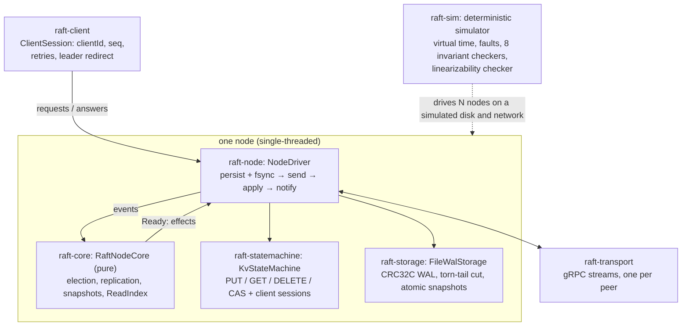

# Distributed-Raft-based-KV-store

A replicated key-value store built on Raft, written from scratch in plain Java 21 with no Raft library
and no framework. The protocol core is a pure, deterministic state machine. A deterministic simulator
runs thousands of seeded chaos runs against it (dropped, duplicated and reordered messages, partitions,
crashes in the middle of an fsync, process pauses) and checks every Raft safety property after every
event, plus linearizability of what clients saw.

## Architecture



## Status

| Milestone | What | State |
|---|---|---|
| M1 | Leader election | done |
| M2 | Log replication, KV state machine, fast log backup | done |
| M3 | Write-ahead log, crash recovery, snapshots, InstallSnapshot | done |
| M4 | Client sessions (exactly-once writes), ReadIndex reads, linearizability checker | done |
| M5 | PreVote, CheckQuorum, gRPC, real server, HTTP API + CLI, Prometheus metrics, kill -9 tests, Docker | done |
| M6 | Group commit, benchmarks ([BENCHMARKS.md](BENCHMARKS.md)), the localhost dashboard | done |

Each milestone ends with a gate of 5,000 seeds × {3, 5} nodes × {chaos, crash loop} with zero
violations, plus deliberately injected bugs ("mutations") that the checkers must catch. Numbers are in
[MILESTONES.md](MILESTONES.md).

## Build and test

```
./gradlew build                                                  # all modules and tests
./gradlew :raft-sim:test --tests '*ChaosTest*' -Psim.seeds=5000  # a milestone gate
./gradlew :raft-sim:test -Psim.seed=1234                         # replay one seed
```

Requires JDK 21 (Gradle's toolchain finds or downloads it).

## Run a cluster

```
docker compose up -d --build                                   # 3 nodes: clients on :8081, :8082, :8083
curl -X PUT localhost:8081/kv/x -d '{"value":"1"}'             # a follower answers 421 {"leaderId":N}
curl -X PUT localhost:808N/kv/x -d '{"value":"1"}'             # the leader: {"previous":null}
curl localhost:8081/kv/x                                       # linearizable read (ReadIndex)
curl -X POST localhost:808N/kv/x/cas -d '{"expected":"1","value":"2"}'
curl localhost:8081/status ; curl localhost:8081/metrics       # role, term, commitIndex; Prometheus
docker compose kill node2 && docker compose start node2        # SIGKILL and recover from the WAL
docker compose down -v                                         # stop and wipe the data volumes
```

Without Docker: `./gradlew :raft-server:installDist`, then start
`raft-server/build/install/raft-server/bin/raft-server` three times with `RAFT_NODE_ID`, `RAFT_PEERS`,
`RAFT_PEER_PORT`, `RAFT_CLIENT_PORT` and `RAFT_DATA_DIR` set (see `ServerConfig`). The same folder has
`bin/raft-cli` (`raft-cli put x 1`, `get x`, `del x`, `cas x 1 2`, `status`), which retries with the same
sequence number and follows leader redirects.

```
./gradlew :raft-server:integrationTest                         # 3 JVMs, kill -9 loop, linearizability
```

## Dashboard and benchmarks

```
./gradlew :raft-dashboard:run                                  # http://localhost:8090 (opens the browser)
./gradlew :raft-bench:run --args="matrix --repeat 3"           # the full throughput matrix (~35 min)
./gradlew :raft-bench:run --args="failover --kills 100"        # kill -9 the leader 100 times
raft-bench load --attach 8081,8082,8083 --label docker         # load-test an already-running cluster
```

Tabs: **Simulator** (run seeds, plant a bug, inspect a failing seed), **Blind bug test** (bugs hidden among
clean seeds, answer key at the end), **Throughput & latency** and **Leader failover** (real server
processes), **Compare runs**, and **Benchmarks** (the measured results, explained). Headline numbers, one
MacBook, every write fsynced on a majority: group commit 148 → 2,075 writes/s at 64 clients (p99 541 → 50
ms); leader failover p50 199 ms, p99 386 ms over 100 `kill -9`s.

## Documents

- [INTERVIEW_PREP.md](INTERVIEW_PREP.md): likely interview questions with plain-language answers, bug stories, demo script
- [BENCHMARKS.md](BENCHMARKS.md): throughput, latency, failover and Docker numbers, with method and limits
- [EXPLANATION.md](EXPLANATION.md): learning notes for every milestone, with diagrams and study questions
- [DESIGN.md](DESIGN.md): decisions and rejected alternatives
- [DEVIATIONS.md](DEVIATIONS.md): every shortcut, and what was skipped on purpose
- [MILESTONES.md](MILESTONES.md): exit criteria, results, mutation catch rates
- [PROJECT_BRIEF.md](PROJECT_BRIEF.md): the original brief
